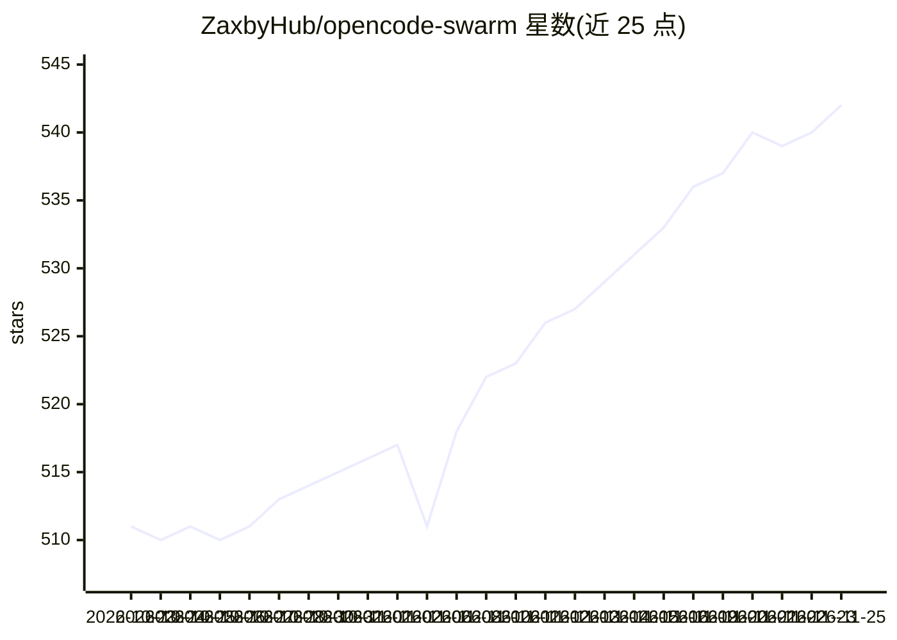

# ZaxbyHub/opencode-swarm

⭐ 542 · TypeScript · MIT · 推送 2026-11-24 · [GitHub](https://github.com/ZaxbyHub/opencode-swarm) · 组织维护

**OpenCode 的多智能体编码插件：架构师主导的分角色协作与质量门禁**

OpenCode Swarm 是 OpenCode 的插件，将单个 AI 编码会话组织为由架构者协调的多个专职 agent（coder、reviewer、test_engineer、critic、sme、docs 等），采用 gated pipeline：代码需经 reviewer 与 test engineer 批准才能交付。提供 Epic 并行波次模式（每任务隔离 worktree）、可恢复会话状态（.swarm/ 目录）、shell 写操作静态检测、范围管控与 SAST/secrets 扫描等防护机制，支持 GitHub 与 GitLab，13 种语言 profile。需 Bun ≥1.3.13 或 Node.js ≥22.13。

## 筛选速览

| 维度 | 判定 | 备注 |
|---|---|---|
| AI 角色 | `ai-native` | 本体是模型或模型工具 |
| 许可风险 | `permissive` | MIT |
| 部署形态 | `desktop` | 安装包/桌面程序 |
| 模型依赖 | — | README 未给出锁定关系 |
| 硬件要求 | — | 无带数字的原话,不猜 |
| 安装摩擦 | `low` | 无编译、无系统依赖或容器化 |
| 成熟度 | — | 结构信号不足 |

## 能力要点

- 架构者自动协调 19+ 个专职 agent，禁止并行越权改码（scope 证明不相交方可并行，各自独立 worktree）
- gated pipeline：代码需 reviewer + test engineer 批准，含 completion-verify 与 drift verifier 门禁
- shell 写操作静态检测（POSIX AST 解析 + PowerShell/cmd 正则）与破坏性命令拦截
- 支持 GitHub 与 GitLab 一等公民，PR 订阅与 CI 状态后台轮询

## 适用场景

- 用多角色 agent 流水线完成从计划到实现、评审、测试的编码任务
- 需要 gate 审批与证据 PR 的受控 AI 编码流程
- 在 GitHub/GitLab 上以 issue 标签触发自动化实现管道

## 场景标签

`多智能体` `编码 Agent` `代码审查` · 领域:Agent 开发

## 证据(README 行号)

> L13: OpenCode Swarm is a plugin for OpenCode that turns a single AI coding session into an **architect-led team of speci
> L25: Most AI coding tools let one model write code and ask that same model whether the code is good. That misses too muc
> L44: - 🌐 **13 full language profiles** (TypeScript, JavaScript, Python, Go, Rust, Java, Kotlin, C/C++, C#, Ruby, Swift, 

## 星数曲线

2026-10-23 511 → 2026-11-25 542（+31）

---
*卡片 v1 · prompt 1.4 · 生成 2026-11-25 · 置信度 mid · 依据 README sha `702afe4c7c8c` · [字段定义](../../DATASET.md)*
