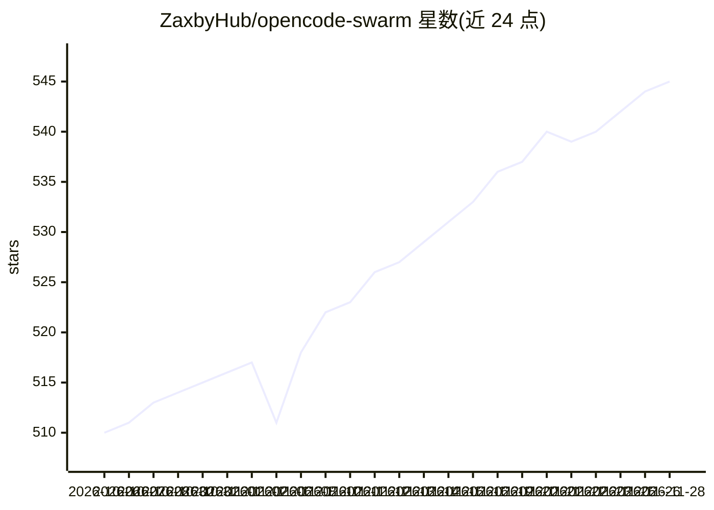

# ZaxbyHub/opencode-swarm

⭐ 545 · TypeScript · MIT · 推送 2026-11-27 · [GitHub](https://github.com/ZaxbyHub/opencode-swarm) · 组织维护

**OpenCode 插件：把单次 AI 编码会话编排为架构师主导的多智能体流水线**

面向 OpenCode 的 agentic swarm 插件，将单个 AI 编码会话转为由 architect 协调的多角色团队（coder、reviewer、test_engineer、critic、sme、docs 等），通过门控流水线强制 reviewer 与测试通过后才交付代码。提供带作用域持久化的写权限管控、shell 写操作静态分析拦截、破坏性命令阻断、逐任务 SAST/secrets/依赖审计、可恢复会话（状态存于 .swarm/）、GitHub/GitLab 集成与 Epic 并行波次模式。安装需 Bun ≥1.3.13 或 Node ≥22.13。

## 筛选速览

| 维度 | 判定 | 备注 |
|---|---|---|
| AI 角色 | `ai-native` | 本体是模型或模型工具 |
| 许可风险 | `permissive` | MIT |
| 部署形态 | `desktop` | 安装包/桌面程序 |
| 模型依赖 | — | README 未给出锁定关系 |
| 硬件要求 | — | 无带数字的原话,不猜 |
| 安装摩擦 | `low` | 无编译、无系统依赖或容器化 |
| 成熟度 | — | 结构信号不足 |

## 能力要点

- 架构师主导的多角色智能体编排与门控流水线（reviewer + 测试工程师审批后交付）
- 作用域强制与 shell 写操作静态检测，阻断破坏性命令
- 13 种语言 profile 与 20 个 tree-sitter 语法的解析校验
- GitHub 网关 Action、PR Monitor（gh CLI）与 GitLab MR 一等支持

## 适用场景

- 在 OpenCode 中用多智能体分工完成一次功能实现
- 要求 AI 生成代码必须通过审查与测试门控才能合入
- 对 AI 编码会话做安全护栏与破坏性命令拦截
- 按阶段并行推进大型计划的 Epic 模式开发

## 场景标签

`多智能体` `编码 Agent` `代码审查` · 领域:Agent 开发

## 证据(README 行号)

> L13: OpenCode Swarm is a plugin for OpenCode that turns a single AI coding session into an **architect-led team of speci
> L34: - 🔒 **Gated pipeline** — code never ships without reviewer + test engineer approval

## 星数曲线

2026-10-26 510 → 2026-11-28 545（+35）

---
*卡片 v1 · prompt 1.4 · 生成 2026-11-28 · 置信度 high · 依据 README sha `9357978d2baf` · [字段定义](../../DATASET.md)*
