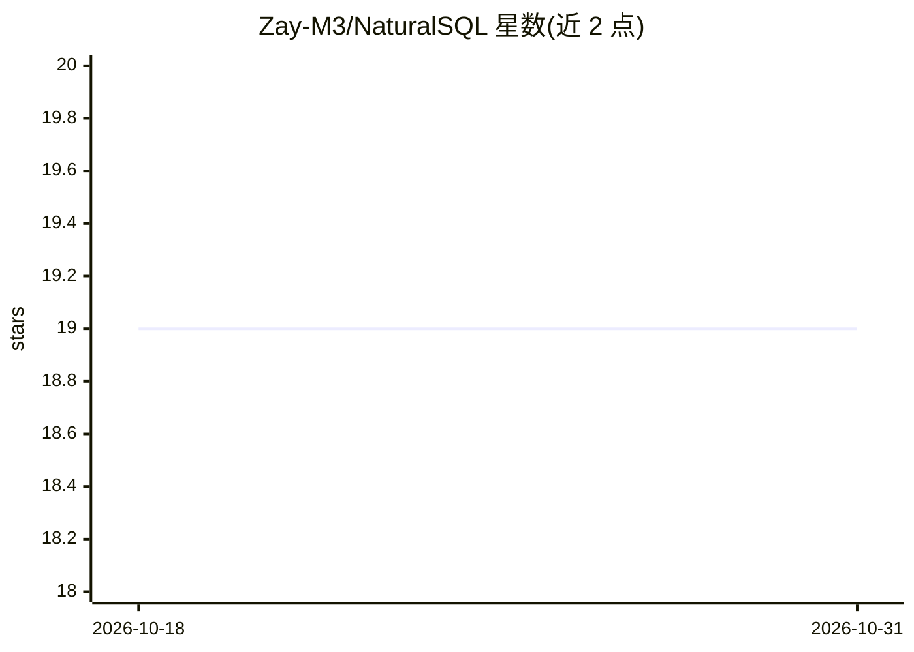

# Zay-M3/NaturalSQL

⭐ 19 · TypeScript · Apache-2.0 · 推送 2026-04-19 · [GitHub](https://github.com/Zay-M3/NaturalSQL) · [官网](https://naturalsql.online/) · 个人维护

**把 SQL 数据库模式向量化，为 LLM 生成 SQL 提供检索上下文的 Python 库**

面向需要在 text-to-SQL 流程中做模式检索的开发者的轻量库：连接 PostgreSQL/MySQL/SQL Server/SQLite 数据库，通过 information_schema 或 PRAGMA 读取表、列、外键结构，归一化为统一字典后生成语义文档并嵌入向量库（chroma 或 sqlite 后端），search() 按自然语言问题返回最相关表与关系上下文，build_prompt() 生成 LLM 提示。嵌入支持本地 sentence-transformers 或 Gemini。当前限制：无混合排序、SQLite 后端用 Python 计算余弦距离、不摄取业务注释。

## 筛选速览

| 维度 | 判定 | 备注 |
|---|---|---|
| AI 角色 | `ai-ecosystem` | LLM/agent 周边工具 |
| 许可风险 | `permissive` | Apache-2.0 |
| 部署形态 | `library` | 以包/库形式分发 |
| 模型依赖 | — | README 未给出锁定关系 |
| 硬件要求 | — | 无带数字的原话,不猜 |
| 安装摩擦 | `medium` | 含编译或系统依赖之一 |
| 成熟度 | — | 结构信号不足 |

## 能力要点

- 支持 PostgreSQL/MySQL/SQL Server/SQLite 四种引擎的模式抽取
- Chroma 与 SQLite 两种向量后端可选
- 本地 sentence-transformers 或 Gemini 两种嵌入提供方
- build_prompt() 直接生成含模式上下文的 LLM 提示

## 适用场景

- 在 text-to-SQL 应用中为 LLM 提供真实表结构上下文
- 大库场景下按问题语义检索相关表而非全量塞入提示
- 轻量本地向量检索，避免引入大型框架

## 场景标签

`RAG` `语义搜索` · 领域:知识与检索

## 证据(README 行号)

> L12: Lightweight library to convert your SQL database schema into a vector database, so LLMs can use real table/column c
> L20: NaturalSQL extracts your database schema, vectorizes it using a configurable backend (`chroma` or `sqlite`) and con
> L227: So the LLM receives real schema context instead of guessing table/column names.

## 星数曲线

2026-10-18 19 → 2026-10-31 19（+0）

---
*卡片 v1 · prompt 1.4 · 生成 2026-10-28 · 置信度 high · 依据 README sha `b7763083a081` · [字段定义](../../DATASET.md)*
