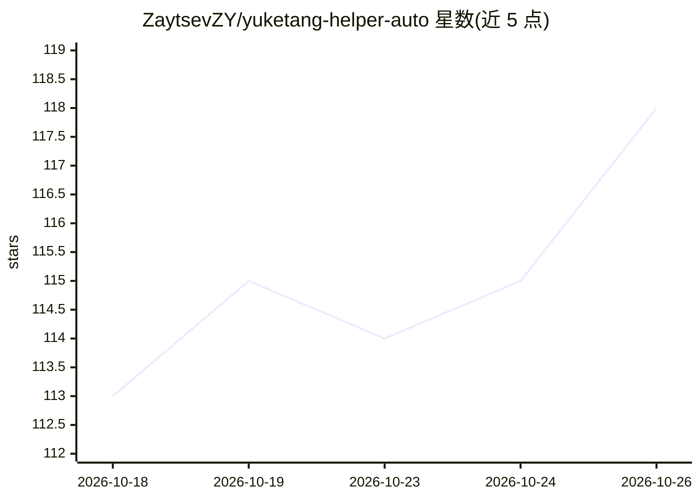

# ZaytsevZY/yuketang-helper-auto

⭐ 118 · JavaScript · NOASSERTION · 推送 2026-10-23 · [GitHub](https://github.com/ZaytsevZY/yuketang-helper-auto) · 个人维护 · 中文 README

**雨课堂学习助手：课件下载、OCR 翻译与 AI 答题辅助**

面向雨课堂/荷塘雨课堂学生的多端助手，提供浏览器扩展（Edge/Chrome）、Windows/macOS 独立客户端与开发中的 Android 端。功能包括课程/考试提醒、课件提前查看与 PDF/图片批量下载、课件文字识别与翻译、课件 AI 问答多轮对话、习题 AI 答题与逐题解答。通过 OpenAI 协议 API 接入模型（GPT/Grok/DeepSeek/GLM/Kimi/MiniMax 等），不支持 Anthropic 协议；API 使用费用由用户承担。构建需 Node.js 24.x 与 npm 11.x，从源码 clone 构建。README 声明仅供学习参考。

## 筛选速览

| 维度 | 判定 | 备注 |
|---|---|---|
| AI 角色 | `ai-native` | 本体是模型或模型工具 |
| 许可风险 | `none` | NOASSERTION |
| 部署形态 | `None` |  |
| 模型依赖 | locked-api |  |
| 硬件要求 | — | 无带数字的原话,不猜 |
| 安装摩擦 | `low` | 无编译、无系统依赖或容器化 |
| 成熟度 | `idea` | |

## 能力要点

- 课件提前查看与 PDF/图片批量下载、特殊缓存
- 课件 OCR、翻译、AI 问答与多轮对话
- 支持 OpenAI 协议模型（GPT/Grok/DeepSeek/GLM/Kimi/MiniMax 等）
- 浏览器扩展 + Windows/macOS 客户端 + 开发中 Android 端，并附 ykt-cli 开发工具

## 适用场景

- 课前提前查看和下载雨课堂课件
- 对课件内容做 OCR、翻译和提问
- 接收课程、作业和考试事件提醒
- 开发者用 ykt-cli 模拟事件与网络进行二次开发

## 场景标签

`OCR` `文档问答` · 领域:知识与检索

## 证据(README 行号)

> L72: 3. **AI辅助学习** :robot:
> L74: - 支持对课件内容进行AI提问和多轮对话
> L122: 目前支持大部分 OpenAI 协议模型，包括 GPT/Grok/DeepSeek/GLM/Kimi/MiniMax 等；不支持 Anthropic 协议的模型。

## 星数曲线

2026-10-18 113 → 2026-10-26 118（+5）

---
*卡片 v1 · prompt 1.4 · 生成 2026-10-23 · 置信度 high · 依据 README sha `9a8950e6bdd2` · [字段定义](../../DATASET.md)*
