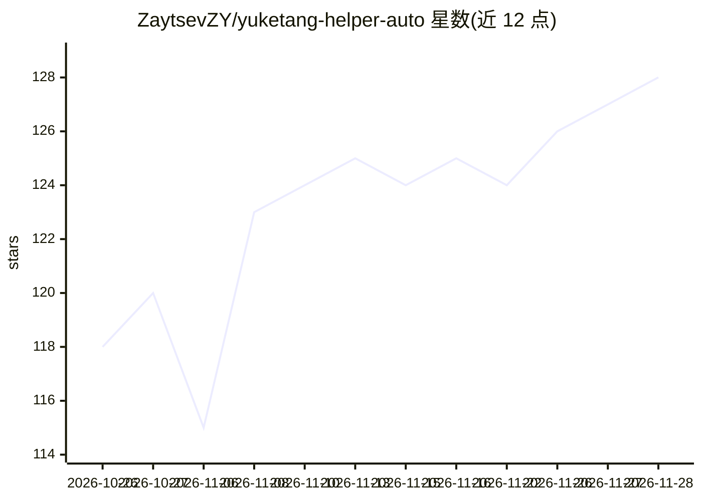

# ZaytsevZY/yuketang-helper-auto

⭐ 128 · JavaScript · NOASSERTION · 推送 2026-11-22 · [GitHub](https://github.com/ZaytsevZY/yuketang-helper-auto) · 个人维护 · 中文 README

**为雨课堂学生提供课件下载、OCR 与 AI 答题的助手**

面向雨课堂/荷塘雨课堂用户的开源助手，提供浏览器扩展（Edge/Chrome）、Windows/macOS 客户端（Electron，源码构建）与开发中的 Android 端。功能包括课堂事件提醒与自动进课堂、课件批量管理与 PDF/图片下载、课件 OCR 与翻译、课件问答与多轮对话、习题 AI 解答及补交。模型通过 OpenAI 协议 API 接入（不支持 Anthropic 协议），API 调用可能产生费用；README 注明仅供学习参考，不线上存储用户信息。

## 筛选速览

| 维度 | 判定 | 备注 |
|---|---|---|
| AI 角色 | `ai-native` | 本体是模型或模型工具 |
| 许可风险 | `none` | NOASSERTION |
| 部署形态 | `None` |  |
| 模型依赖 | — | README 未给出锁定关系 |
| 硬件要求 | — | 无带数字的原话,不猜 |
| 安装摩擦 | `low` | 无编译、无系统依赖或容器化 |
| 成熟度 | — | 结构信号不足 |

## 能力要点

- 支持课件文字识别、翻译与多轮 AI 对话
- 支持课堂习题与已结束考试的逐题 AI 解答
- 课件批量管理与 PDF/图片格式下载
- 同时提供浏览器扩展与 Electron 桌面客户端

## 适用场景

- 下载和管理雨课堂课件为 PDF/图片
- 对课件内容提问并多轮对话辅助复习
- 在课堂事件发生时收到提醒并自动进入课堂

## 场景标签

`OCR` `文档问答` · 领域:知识与检索

## 证据(README 行号)

> L72: 3. **AI辅助学习** :robot:
> L74: - 支持对课件内容进行AI提问和多轮对话
> L76: - 支持对作业和已结束的考试进行逐题AI解答

## 星数曲线

2026-10-26 118 → 2026-11-28 128（+10）

---
*卡片 v1 · prompt 1.4 · 生成 2026-11-28 · 置信度 high · 依据 README sha `04163f0b2a39` · [字段定义](../../DATASET.md)*
