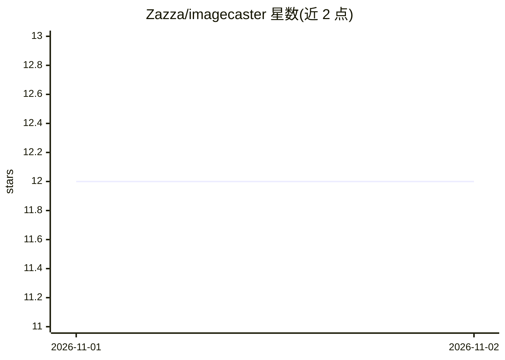

# Zazza/imagecaster

⭐ 12 · Go · AGPL-3.0 · 推送 2026-10-31 · [GitHub](https://github.com/Zazza/imagecaster) · 个人维护 · 中文 README

**本地 Stable Diffusion + LLM 桌面图像生成与编辑应用**

基于 Wails (Go + Vue 3) 的桌面应用：用户用自然语言描述场景，由本地 OpenAI 兼容 LLM（Ollama/llama.cpp/LM Studio）生成 SD 提示词，再通过本地 Stable Diffusion WebUI（推荐 Forge / Forge Neo）产出图像。功能包括文生图、图生图（Remix）、指令式编辑、蒙版智能移除、多步骤 Pipeline、ESRGAN 质量输出、模型目录一键下载（服务器模式）与儿童模式。内置 MCP 服务器可供 AI agent 调用。需要用户自建 SD WebUI 与 LLM 服务。

## 筛选速览

| 维度 | 判定 | 备注 |
|---|---|---|
| AI 角色 | `ai-native` | 本体是模型或模型工具 |
| 许可风险 | `viral` | AGPL-3.0 |
| 部署形态 | `desktop` | 安装包/桌面程序 |
| 模型依赖 | local-ok | 支持本地模型 |
| 硬件要求 | — | 无带数字的原话,不猜 |
| 安装摩擦 | `low` | 无编译、无系统依赖或容器化 |
| 成熟度 | — | 结构信号不足 |

## 能力要点

- 自然语言描述由 LLM 合成 SD 提示词，风格预设携带技术参数
- 指令式编辑与智能移除（蒙版 + LLM 上下文分析自动修补）
- 多步骤 Pipeline 可组装、保存并以 JSON 导入导出
- 内置 MCP 服务器（sd-mcp），可由 AI agent 驱动

## 适用场景

- 用大白话描述场景直接生图，不想调采样器和 CFG
- 对真实照片做指令式编辑（如换裤子为裙子）
- 对比测试不同模型与预设的出图效果

## 场景标签

`图像生成` · 领域:内容生成

## 证据(README 行号)

> L3: **AI-powered desktop app for image generation with Stable Diffusion + LLM.**
> L7: **Why does this exist?** Raw Stable Diffusion is powerful but hostile: every image means fiddling with samplers, CFG
> L9: > **Note:** Imagecaster connects to your local Stable Diffusion WebUI (Forge / Forge Neo recommended — see Setup Gui

## 星数曲线

2026-11-01 12 → 2026-11-02 12（+0）

---
*卡片 v1 · prompt 1.4 · 生成 2026-11-01 · 置信度 high · 依据 README sha `4f0ba8ee7137` · [字段定义](../../DATASET.md)*
