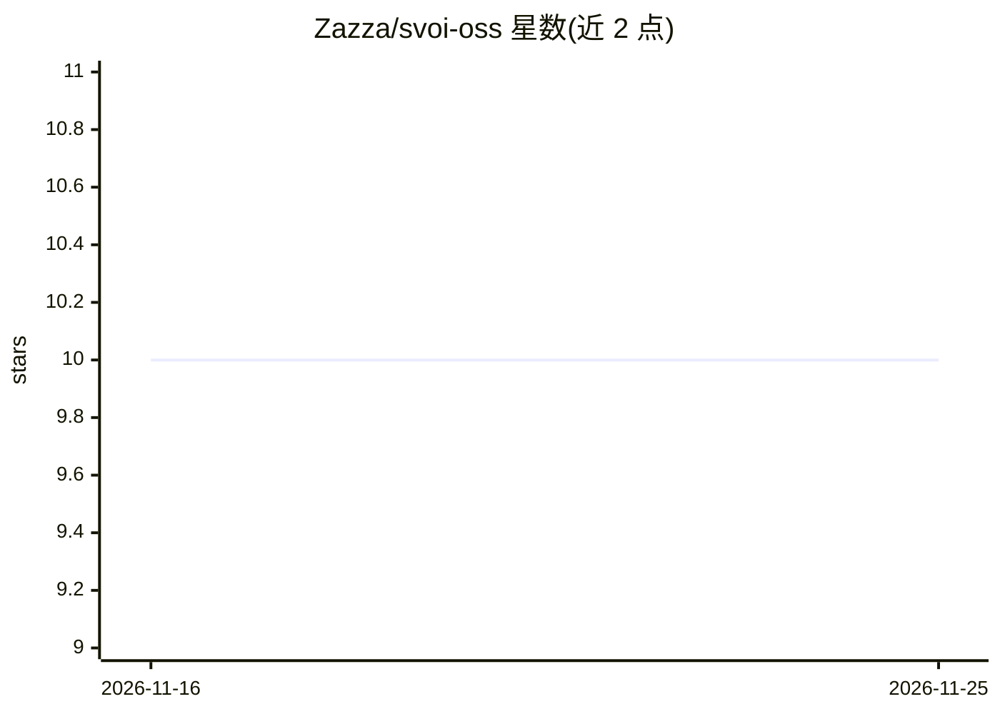

# Zazza/svoi-oss

⭐ 10 · Go · AGPL-3.0 · 推送 2026-07-28 · [GitHub](https://github.com/Zazza/svoi-oss) · [官网](https://svoi-ai.ru) · 组织维护 · 中文 README

**自托管开源个人 AI 助手：聊天、记忆、RAG 与日程**

以 Go + Vue 3 + PostgreSQL/pgvector 实现的自托管个人 AI 助手，OSS 版不含计费。提供 SSE 流式聊天与 agentic 工具（web_search、browse、generate_image）、基于 pgvector 的长期记忆与 RAG 知识库、自定义助手模板、任务提醒与主动调度器。运营者配置单一 LLM provider（本地 Ollama 或任意 OpenAI 兼容云端）服务全部用户，支持主备故障转移链。通过 Docker Compose 与 Makefile 部署，含管理面板。

## 筛选速览

| 维度 | 判定 | 备注 |
|---|---|---|
| AI 角色 | `ai-native` | 本体是模型或模型工具 |
| 许可风险 | `viral` | AGPL-3.0 |
| 部署形态 | `self-host` | docker 或自建部署 |
| 模型依赖 | local-ok | 支持本地模型 |
| 硬件要求 | — | 无带数字的原话,不猜 |
| 安装摩擦 | `low` | 无编译、无系统依赖或容器化 |
| 成熟度 | — | 结构信号不足 |

## 能力要点

- 流式聊天与 agentic 工具：web_search、search_site、browse、generate_image
- 长期记忆与 RAG 知识库，文档分块嵌入并由后台处理
- 外部 RAG 经端到端加密盲中继索引本地 PC 文件，服务器不持有密钥
- 多 provider LLM 链与熔断故障转移，含用户/模板/安全事件管理面板

## 适用场景

- 自托管一个了解自己长期上下文的个人 AI 助手
- 用本地 Ollama 模型搭建不依赖云端的家庭/个人助手
- 对接桌面端 svoi-rag 客户端对本地文件做加密检索

## 场景标签

`Agent 记忆` `AI 助手` `聊天机器人` `RAG` · 领域:Agent 开发

## 证据(README 行号)

> L3: **Svoi** ("Свой" — *your own*) is a self-hosted, open-source personal AI assistant that
> L50: - **Streaming chat** over server-sent events (SSE) with agentic tools:
> L53: - **RAG knowledge base** — documents are chunked and embedded; processed in the background.

## 星数曲线

2026-11-16 10 → 2026-11-25 10（+0）

---
*卡片 v1 · prompt 1.4 · 生成 2026-11-20 · 置信度 high · 依据 README sha `0619e2b66cf7` · [字段定义](../../DATASET.md)*
