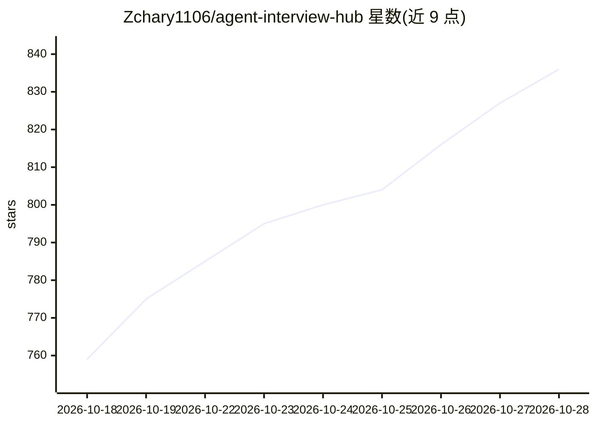

# Zchary1106/agent-interview-hub

⭐ 836 · HTML · MIT · 推送 2026-10-23 · [GitHub](https://github.com/Zchary1106/agent-interview-hub) · 个人维护 · 中文 README

**国内 AI Agent 工程师面试题库与学习路线知识库**

面向准备国内大厂及海外 AI 公司 Agent 岗位的工程师，收录 300+ 面试题与参考答案、35 篇通用知识文档（覆盖 RAG、MCP、LangChain、推理部署、Agent 评测等）、16 周学习路线图、6 道限时实操考题，以及阿里、字节、OpenAI、Anthropic 等 15 类公司/岗位面经资料。支持 GitHub Pages 在线浏览与本地构建静态站，内置可安装到 Copilot CLI、Claude Code、Cursor 等平台的面经采集 Agent，从牛客、小红书等公开来源整理面经。以 MIT 协议开源，接受面经与题目贡献。

## 筛选速览

| 维度 | 判定 | 备注 |
|---|---|---|
| AI 角色 | `ai-knowledge` | 知识聚合/清单类 |
| 许可风险 | `permissive` | MIT |
| 部署形态 | `library` | 以包/库形式分发 |
| 模型依赖 | — | README 未给出锁定关系 |
| 硬件要求 | — | 无带数字的原话,不猜 |
| 安装摩擦 | `low` | 无编译、无系统依赖或容器化 |
| 成熟度 | — | 结构信号不足 |

## 能力要点

- 300+ 面试题全部附参考答案，含 69 道八股题详解
- 15 类公司/岗位面经资料，覆盖国内大厂与 OpenAI、Anthropic 等海外公司
- 内置 Interview Collector Agent，可安装到 Copilot CLI、Claude Code、Cursor 等平台采集面经
- 提供 GitHub Pages 在线阅读、本地 Markdown 阅读、本地构建静态站三种使用方式

## 适用场景

- 求职大厂 Agent 岗位时按公司刷对应面经与高频题
- 按 16 周学习路线系统补齐 Agent 工程知识
- 用 6 道限时实操考题模拟真实面试场景
- 用内置 Agent 从公开来源收集整理新面经并贡献回库

## 场景标签

`教程课程` · 领域:学习与行业

## 证据(README 行号)

> L10: **300+ 面试题与参考答案 · 15 类公司/岗位资料（含 Anthropic 等海外顶级 AI 公司）· 6 道实操考题 · 16 周完整学习路线图**
> L16: 专为**国内大厂 AI Agent 工程师**跳槽/求职打造的一站式面试知识库。
> L19: - 📚 **包含什么** — 300+ 高频问题与参考答案、15 类公司/岗位资料、6 道限时实操考题、35 篇通用知识文档

## 星数曲线

2026-10-18 759 → 2026-10-28 836（+77）

---
*卡片 v1 · prompt 1.4 · 生成 2026-10-21 · 置信度 mid · 依据 README sha `3c76d8a1c89f` · [字段定义](../../DATASET.md)*
