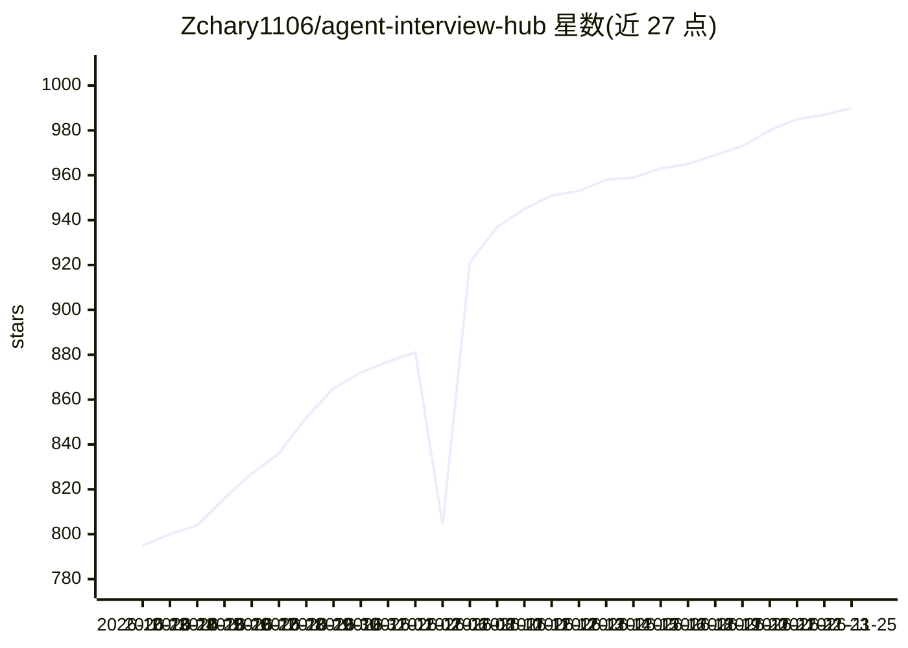

# Zchary1106/agent-interview-hub

⭐ 990 · HTML · MIT · 推送 2026-10-23 · [GitHub](https://github.com/Zchary1106/agent-interview-hub) · 个人维护 · 中文 README

**面向国内大厂 AI Agent 岗位求职者的面试知识库**

以 Markdown 文档组织的 AI Agent 工程师面试资料库：收录 300+ 面试题与参考答案、15 类公司/岗位资料、6 道限时实操考题、16 周学习路线图，覆盖阿里、字节等国内大厂与 OpenAI、Anthropic 等海外公司面经。内容按基础层、核心技术、面试题库、进阶题组织，支持 GitHub Pages 在线浏览，可本地用 Python 脚本构建静态站。内置 Interview Collector Agent 用于从牛客、知乎等公开来源采集面经，可安装到 Copilot CLI、Claude Code、Cursor 等平台。README 注明答案未经独立专家逐题复核，非公司官方真题。

## 筛选速览

| 维度 | 判定 | 备注 |
|---|---|---|
| AI 角色 | `ai-knowledge` | 知识聚合/清单类 |
| 许可风险 | `permissive` | MIT |
| 部署形态 | `library` | 以包/库形式分发 |
| 模型依赖 | — | README 未给出锁定关系 |
| 硬件要求 | — | 无带数字的原话,不猜 |
| 安装摩擦 | `low` | 无编译、无系统依赖或容器化 |
| 成熟度 | — | 结构信号不足 |

## 能力要点

- 300+ 面试题与参考答案、15 类公司/岗位资料、16 周学习路线图
- 覆盖 9 家国内大厂与 5 类海外 AI 公司的岗位要求、面试题与真实面经
- 内置 Interview Collector Agent 可安装到 Copilot CLI/Claude Code/Cursor 等平台采集面经
- 提供 6 道限时实操考题与 GitHub Pages 在线阅读

## 适用场景

- 准备国内大厂 AI Agent 工程师岗位跳槽面试
- 按 16 周路线图系统学习 Agent/RAG/MCP 等知识
- 用实操考题模拟真实面试限时编程场景
- 通过采集 Agent 跟踪最新公开面经

## 场景标签

`教程课程` · 领域:学习与行业

## 证据(README 行号)

> L16: 专为**国内大厂 AI Agent 工程师**跳槽/求职打造的一站式面试知识库。
> L19: - 📚 **包含什么** — 300+ 高频问题与参考答案、15 类公司/岗位资料、6 道限时实操考题、35 篇通用知识文档

## 星数曲线

2026-10-23 795 → 2026-11-25 990（+195）

---
*卡片 v1 · prompt 1.4 · 生成 2026-11-24 · 置信度 high · 依据 README sha `91546d815772` · [字段定义](../../DATASET.md)*
