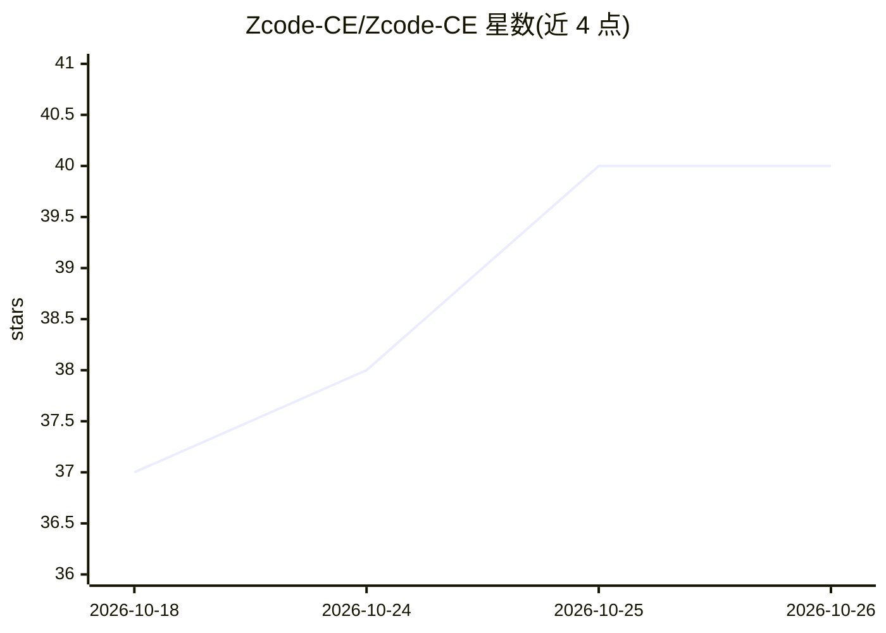

# Zcode-CE/Zcode-CE

⭐ 40 · TypeScript · Apache-2.0 · 推送 2026-10-14 · [GitHub](https://github.com/Zcode-CE/Zcode-CE) · 组织维护 · 中文 README

**AI 编程工作台 ZCode 的开源社区版：桌面/Web/终端三种形态**

基于 zai-org/ZCode（Apache-2.0）构建的社区维护版本，含 Electron 桌面应用、浏览器面板与终端 Agent CLI。与官方版的差异包括：移除遥测、Office 文档与 Computer Use 改用 MIT 开源实现、无头服务器模式（默认仅监听回环、非回环须带令牌）、危险命令精细授权。模型访问与计费仍由 Z.ai/智谱官方服务提供，本项目不代理不转售。已知限制：Linux 桌面自动化实验性、Windows 构建未签名、macOS 无自动更新、CLI/Web 发行包仅支持 Linux-x64（glibc）。

## 筛选速览

| 维度 | 判定 | 备注 |
|---|---|---|
| AI 角色 | `ai-native` | 本体是模型或模型工具 |
| 许可风险 | `permissive` | Apache-2.0 |
| 部署形态 | `desktop` | 安装包/桌面程序 |
| 模型依赖 | — | README 未给出锁定关系 |
| 硬件要求 | — | 无带数字的原话,不猜 |
| 安装摩擦 | `low` | 无编译、无系统依赖或容器化 |
| 成熟度 | `idea` | |

## 能力要点

- 桌面应用、浏览器面板、终端 Agent 三种使用形态
- 无遥测，Office 文档与 Computer Use 改为 MIT 开源实现
- 无头服务器 + 浏览器面板模式，支持手机窄屏操作
- 危险命令不生成宽泛持久授权，授权范围三种粒度明示

## 适用场景

- 在桌面、浏览器或终端中使用 AI 编程工作台
- 在无桌面环境的服务器上自托管工作台并用浏览器远程操作
- 需要无遥测、权限可控的 AI 编程环境

## 场景标签

`编码 Agent` `GUI 自动化` · 领域:效率与自动化

## 证据(README 行号)

> L11: ZCode-CE 是 AI 编程工作台 **ZCode 的开源社区版**，提供桌面应用、浏览器界面和终端 Agent。本仓库包含客户端、后端服务、共享 UI，以及 Agent CLI 与运行时源码。
> L15: ZCode-CE 基于 zai-org/ZCode（Apache-2.0）构建，面向希望**完全掌控自己开发环境**的用户。**欢迎社区成员参与建设** —— 无论是功能开发、问题反馈还是文档改进。
> L237: 模型访问、套餐与计费由 Z.ai / 智谱 提供，本项目不代理、不转售。

## 星数曲线

2026-10-18 37 → 2026-10-26 40（+3）

---
*卡片 v1 · prompt 1.4 · 生成 2026-10-25 · 置信度 high · 依据 README sha `40518c086720` · [字段定义](../../DATASET.md)*
