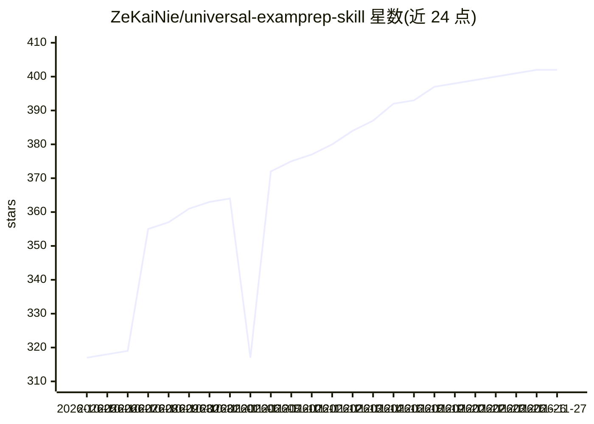

# ZeKaiNie/universal-examprep-skill

⭐ 402 · Python · MIT · 推送 2026-10-27 · [GitHub](https://github.com/ZeKaiNie/universal-examprep-skill) · [官网](https://github.com/ZeKaiNie/universal-examprep-skill/releases/latest) · 个人维护 · 中文 README

**给备考学生的 AI 复习教练：按讲义逐章教学并防幻觉**

以 Agent Skill 形式安装到 Claude Code、Codex、Cursor 等编码代理中的备考教练：读取讲义/笔记/作业/真题文件夹，按章节拆分课程，逐章讲解并附 file p.N 页码引用；自动裁剪讲义插图、用真实作业题组卷测验、记录错题并生成小抄。核心机制包括三级来源标签（材料原文/AI 补充/AI 生成答案）、基于 study_state.json 的跨会话记忆，以及在小型弱模型上运行的确定性 CLI 输出。需要 Python 3.8+ 与一个编码代理；PDF 功能需可选安装 pypdfium2。

## 筛选速览

| 维度 | 判定 | 备注 |
|---|---|---|
| AI 角色 | `ai-native` | 本体是模型或模型工具 |
| 许可风险 | `permissive` | MIT |
| 部署形态 | `desktop` | 安装包/桌面程序 |
| 模型依赖 | — | README 未给出锁定关系 |
| 硬件要求 | — | 无带数字的原话,不猜 |
| 安装摩擦 | `low` | 无编译、无系统依赖或容器化 |
| 成熟度 | — | 结构信号不足 |

## 能力要点

- 每个讲授概念附 file p.N 页码引用，范围外提问以非零状态退出以阻止编造
- study_state.json 本地跨会话记忆与错题间隔重测，无需外部向量数据库
- 从讲义与作业中自动裁剪插图并按题匹配参考答案
- 在 Gemini Flash-Lite、Claude Haiku 等小型模型上可运行

## 适用场景

- 期末复习时让教练按章节带我过一遍讲义
- 考前用历年真题和作业题刷题并记录错题
- 几天后继续上次的复习进度
- 考试前整理一份小抄 cheatsheet.md

## 场景标签

`AI 助手` · 领域:对话与助手

## 证据(README 行号)

> L26: Exam Cram Coach is an Agent Skill plus one small Python tool. You give a coding agent (Claude Code, Codex, Cursor, 
> L28: 1. **🎯 100% Grounded & Anti-Hallucination**: Every taught concept cites exact `file p.N` references; out-of-scope q
> L33: - reads PDF / PPTX / DOCX / Markdown / TXT / HTML and splits the course into chapters;

## 星数曲线

2026-10-25 317 → 2026-11-27 402（+85）

---
*卡片 v1 · prompt 1.4 · 生成 2026-11-25 · 置信度 mid · 依据 README sha `e0d97d418133` · [字段定义](../../DATASET.md)*
