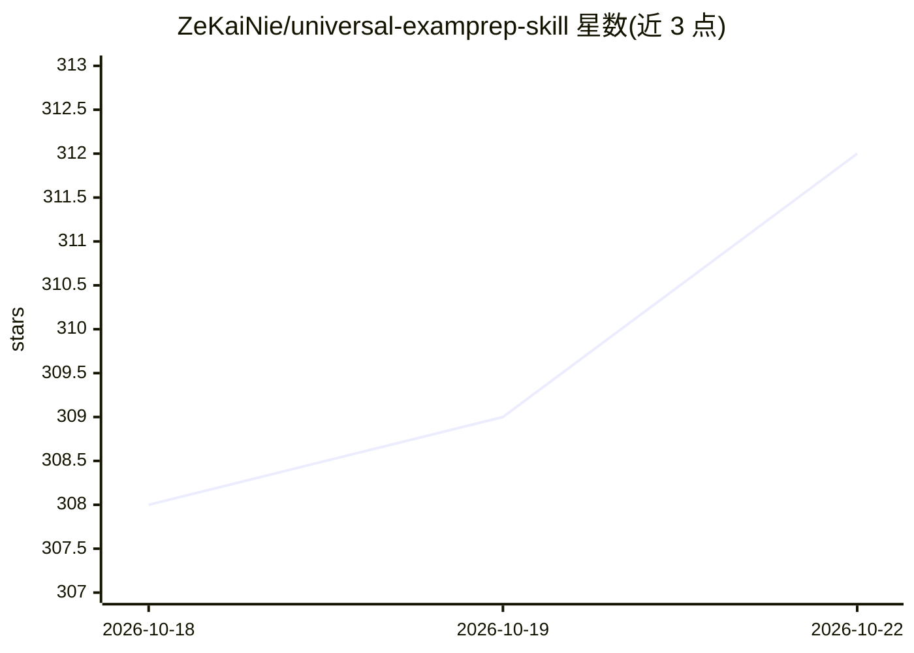

# ZeKaiNie/universal-examprep-skill

⭐ 312 · Python · MIT · 推送 2026-10-19 · [GitHub](https://github.com/ZeKaiNie/universal-examprep-skill) · [官网](https://github.com/ZeKaiNie/universal-examprep-skill/releases/latest) · 个人维护 · 中文 README

**面向编码 agent 的备考教练技能：从讲义教学、出题测验到小抄**

以 Agent Skill 形式分发的 AI 备考工具，配合 Claude Code、Codex、Cursor、Windsurf、Antigravity、Gemini CLI 等 40+ 编码 agent 使用：用户放入课件、笔记、作业与历年试题，工具读取 PDF/PPTX/DOCX/Markdown/TXT/HTML 并分章，逐章讲解并标注 file p.N 出处，用 pypdfium2 从 PDF 裁剪插图，用真题测验并记录错题（study_state.json 本地持久化），生成小抄。区分 Flash 与 Full 两版，Flash 约 1,600 词、支持小模型（测试于 Gemini Flash-Lite 与 Claude Haiku）。限制：PDF 功能依赖可选的 pypdfium2，需 Python 3.8+。

## 筛选速览

| 维度 | 判定 | 备注 |
|---|---|---|
| AI 角色 | `ai-native` | 本体是模型或模型工具 |
| 许可风险 | `permissive` | MIT |
| 部署形态 | `desktop` | 安装包/桌面程序 |
| 模型依赖 | — | README 未给出锁定关系 |
| 硬件要求 | — | 无带数字的原话,不猜 |
| 安装摩擦 | `low` | 无编译、无系统依赖或容器化 |
| 成熟度 | — | 结构信号不足 |

## 能力要点

- 每条讲解标注 🟢/🟡/⚠️ 出处标签与 file p.N 页码引用
- coach.py 管理学习状态与错题本，跨会话本地恢复
- 自动配对作业题与参考答案（hw2.pdf ↔ hw2solutions.pdf）并按剩余天数排学习计划
- 从讲义 PDF 自动裁剪插图与题目配图

## 适用场景

- 期末冲刺时让 AI 按我的课件逐章讲解并给出处
- 用它用我的真题出题测验、记录错题并间隔重测
- 考前汇总生成个人小抄 cheatsheet.md

## 场景标签

 · 领域:教育/AI 导师

## 证据(README 行号)

> L5: *An AI exam-prep tutor for Claude Code, Codex, Cursor, Windsurf, Antigravity and Gemini CLI: drop in your lecture sl
> L23: Exam Cram Coach is an Agent Skill plus one small Python tool. You give a coding agent (Claude Code, Codex, Cursor, 
> L25: 1. **🎯 100% Grounded & Anti-Hallucination**: Every taught concept cites exact `file p.N` references; out-of-scope q

## 星数曲线

2026-10-18 308 → 2026-10-22 312（+4）

---
*卡片 v1 · prompt 1.4 · 生成 2026-10-22 · 置信度 mid · 依据 README sha `7455d4e0c729` · [字段定义](../../DATASET.md)*
