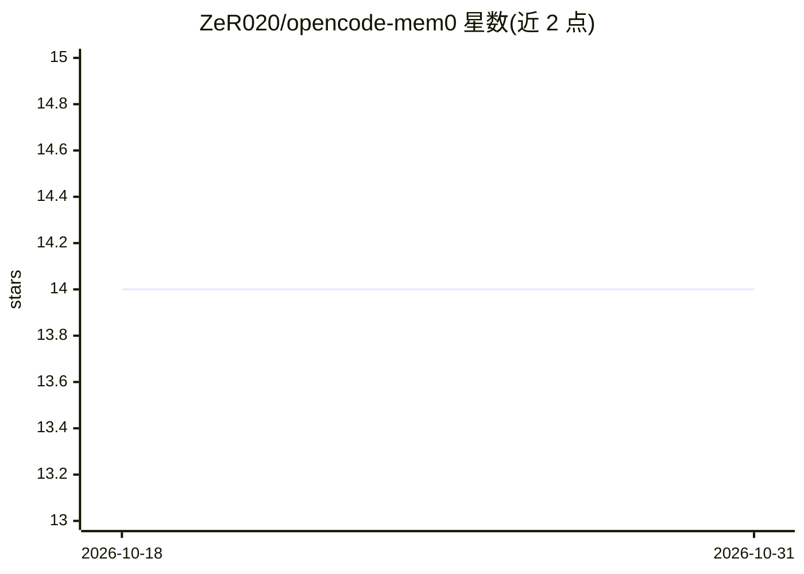

# ZeR020/opencode-mem0

⭐ 14 · TypeScript · MIT · 推送 2026-09-24 · [GitHub](https://github.com/ZeR020/opencode-mem0) · [官网](https://github.com/ZeR020/opencode-mem0) · 个人维护

**为 OpenCode 编码 agent 提供本地持久记忆的插件**

面向 OpenCode 编码 agent 的 npm 插件，用 SQLite + usearch 本地向量数据库为 agent 建立持久记忆：从会话自动抽取记忆（auto-capture），经 7 因子评分与 STM/LTM 双存储生命周期管理（遗忘曲线衰减、阈值晋升/归档），在聊天消息中注入相关记忆并在会话压缩后恢复上下文。向量检索用本地嵌入模型（CPU 运行，首次下载约 547MB），记忆抽取需配置 OpenAI/Anthropic/Google 等 provider；未配置时自动抽取跳过，手动记忆工具与 Web UI 仍可用。附带 localhost:4747 的记忆管理界面，支持项目级配置覆盖全局配置。

## 筛选速览

| 维度 | 判定 | 备注 |
|---|---|---|
| AI 角色 | `ai-ecosystem` | LLM/agent 周边工具 |
| 许可风险 | `permissive` | MIT |
| 部署形态 | `library` | 以包/库形式分发 |
| 模型依赖 | — | README 未给出锁定关系 |
| 硬件要求 | `cpu-ok` | |
| 安装摩擦 | `low` | 无编译、无系统依赖或容器化 |
| 成熟度 | — | 结构信号不足 |

## 能力要点

- 本地 SQLite + usearch 向量数据库存储，无需云服务
- STM/LTM 双存储生命周期与 7 因子记忆强度评分
- 向量 + FTS5 全文混合检索，记忆注入到聊天消息
- 127.0.0.1:4747 的记忆浏览/搜索/管理 Web UI

## 适用场景

- 让编码 agent 记住我的偏好与项目配置，跨会话复用
- 在 OpenCode 会话压缩后不丢失关键上下文
- 在本地浏览、搜索、删除 agent 积累的记忆

## 场景标签

`Agent 记忆` · 领域:Agent 开发

## 证据(README 行号)

> L3: OpenCode plugin that gives coding agents persistent memory using a local vector database (SQLite + usearch). No clou
> L60: The plugin exposes a `memory` tool to the OpenCode agent with six modes:

## 星数曲线

2026-10-18 14 → 2026-10-31 14（+0）

---
*卡片 v1 · prompt 1.4 · 生成 2026-10-31 · 置信度 high · 依据 README sha `d113ff4b3784` · [字段定义](../../DATASET.md)*
