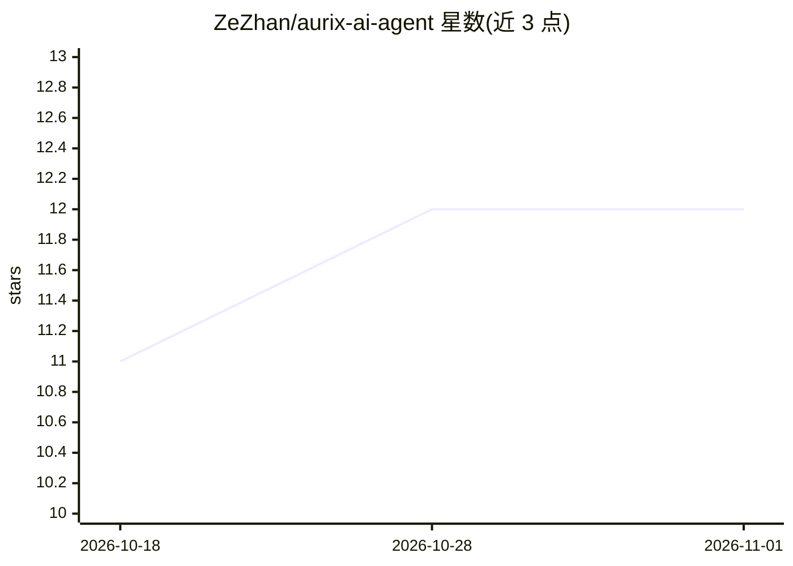

# ZeZhan/aurix-ai-agent

⭐ 12 · Python · Apache-2.0 · 推送 2026-10-21 · [GitHub](https://github.com/ZeZhan/aurix-ai-agent) · [官网](https://zezhan.github.io/aurix-ai-agent/) · 个人维护 · 中文 README

**VS Code 中用 Copilot+MCP 生成、编译、烧写 AURIX 固件的助手**

面向 Infineon AURIX 嵌入式开发者的固件开发助手：以 VS Code 扩展（aurix-ai-agent-extension）与 Python MCP 服务器（aurix-mcp-server-py）组成，通过 GitHub Copilot Agent 模式调用 AURIX MCP 工具——创建 iLLD 工程、用 GCC 编译、经 AURIX Flasher 经 USB 烧写到板卡、搜索捆绑的 TC2xx/TC3xx/TC4Dx 文档与公开 iLLD 示例。内置多套 AURIX 技能文件供 Copilot 遵循。限制：打包 VSIX 仅支持 Windows x64，需安装 AURIX IDE（免费提供 GCC 与 Flasher）。

## 筛选速览

| 维度 | 判定 | 备注 |
|---|---|---|
| AI 角色 | `ai-ecosystem` | LLM/agent 周边工具 |
| 许可风险 | `permissive` | Apache-2.0 |
| 部署形态 | `None` |  |
| 模型依赖 | — | README 未给出锁定关系 |
| 硬件要求 | — | 无带数字的原话,不猜 |
| 安装摩擦 | `medium` | 含编译或系统依赖之一 |
| 成熟度 | — | 结构信号不足 |

## 能力要点

- 一条自然语言指令完成工程创建→GCC 编译→USB 烧写全流程
- 8 个 AURIX MCP 工具：建工程、编译、烧写、文档/示例检索、iLLD 安装
- 捆绑 TC2xx/TC3xx/TC4Dx 文档检索，带设备感知路由与 PDF 页码引用
- 技能文件（行为实现、跨设备/跨厂商移植、iLLD 查询）注入 Copilot

## 适用场景

- 用一句话生成 AURIX 闪烁灯等基础固件并直接烧板
- 在 Copilot 里查 AURIX 文档与 iLLD API 完成外设开发
- 把 NXP/ST/Renesas/TI 的 MCU 示例评估并移植到 AURIX

## 场景标签

`编码 Agent` · 领域:编码与开发

## 证据(README 行号)

> L5: **AURIX AI Agent is a firmware development assistant powered by GitHub Copilot and the Model Context Protocol (MCP) 
> L83: - **aurix-mcp-server-py** — Model Context Protocol server (Python) exposing the AURIX tools above.

## 星数曲线

2026-10-18 11 → 2026-11-01 12（+1）

---
*卡片 v1 · prompt 1.4 · 生成 2026-11-01 · 置信度 high · 依据 README sha `caa240816db1` · [字段定义](../../DATASET.md)*
