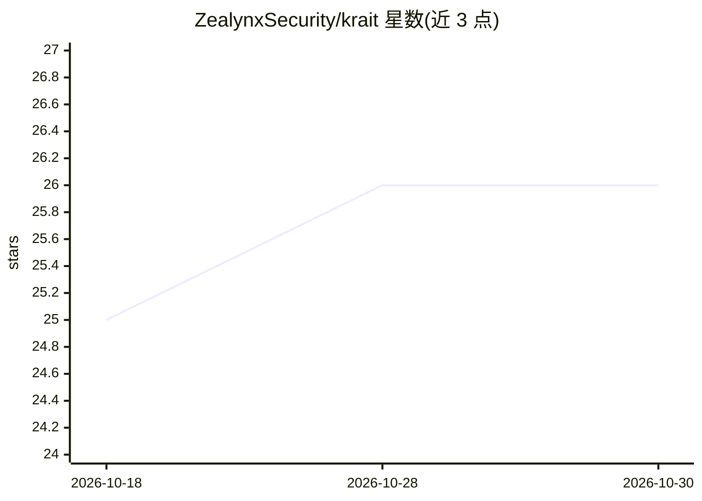

# ZealynxSecurity/krait

⭐ 26 · TypeScript · MIT · 推送 2026-10-27 · [GitHub](https://github.com/ZealynxSecurity/krait) · [官网](https://krait.zealynx.io) · 组织维护

**面向 Solidity 审计员的 AI 辅助安全审计方法论，运行于 Claude Code**

由 Zealynx Security 维护的智能合约安全审计工具，以 Claude Code skills 与 checklist 插件两种本地形态提供：/krait 执行侦察、16 角度检测、状态分析、8 道淘汰门验证的多阶段流水线，输出带 file:line 与利用链的结构化报告；/krait:scan 提供 39 个 DeFi 垂直 845 项检查清单。自测基线 v8 在 5 场 Code4rena 盲测中 10 真阳性、0 假阳性、召回 15.2%。需 Claude Code 与 Claude 订阅，另有免费 Web 平台。

## 筛选速览

| 维度 | 判定 | 备注 |
|---|---|---|
| AI 角色 | `ai-native` | 本体是模型或模型工具 |
| 许可风险 | `permissive` | MIT |
| 部署形态 | `library` | 以包/库形式分发 |
| 模型依赖 | — | README 未给出锁定关系 |
| 硬件要求 | — | 无带数字的原话,不猜 |
| 安装摩擦 | `low` | 无编译、无系统依赖或容器化 |
| 成熟度 | — | 结构信号不足 |

## 能力要点

- 101 启发式 + 26 分析模块 + 8 淘汰门的多阶段审计流水线
- 16 角度（4 镜头 × 4 心态）逐函数检测与共识评分
- 845 项检查、39 个 DeFi 垂直的审计就绪度清单插件
- 50 场历史 Code4rena 竞赛盲测结果存于 shadow-audits/ 可核验

## 适用场景

- 提交正式审计前自查 Solidity 项目的潜在漏洞
- 按 DeFi 垂直清单评估项目的审计就绪度
- 对被淘汰的候选发现做二次人工复核

## 场景标签

`网络安全` · 领域:学习与行业

## 证据(README 行号)

> L3: **AI-assisted security verification for Solidity smart contracts.** Not a scanner — a structured methodology with 10
> L48: Krait is a structured audit methodology encoded as Claude Code skills. When you run `/krait` on a Solidity project,

## 星数曲线

2026-10-18 25 → 2026-10-30 26（+1）

---
*卡片 v1 · prompt 1.4 · 生成 2026-10-27 · 置信度 mid · 依据 README sha `9bc2d417649a` · [字段定义](../../DATASET.md)*
