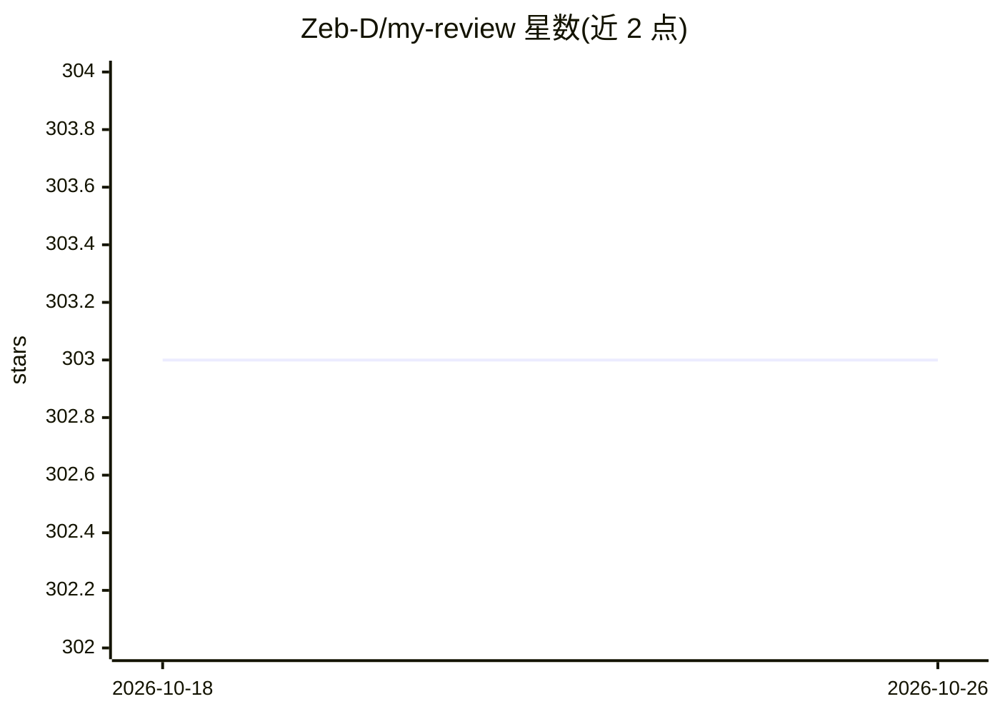

# Zeb-D/my-review

⭐ 303 · NOASSERTION · 推送 2026-10-11 · [GitHub](https://github.com/Zeb-D/my-review) · 个人维护 · 中文 README

**IT 后端工程师的个人系统性学习笔记知识库**

个人维护的后端技术学习笔记仓库，按 AI/机器学习、数据存储（MySQL/HBase/Redis/TiDB）、分布式、GoLang、Java/JVM/Spring、Kubernetes、Linux、管理、中间件（Kafka/dubbo/Zookeeper 等）、网络协议等类别组织数百篇 Markdown 文章，内容含源码解析、原理分析与运维总结。文档用 Typora 编辑，采用 CC 知识共享协议发布，配套微信公众号与知乎分享。属于个人学习输出而非可安装运行的软件产品。

## 筛选速览

| 维度 | 判定 | 备注 |
|---|---|---|
| AI 角色 | `ai-knowledge` | 知识聚合/清单类 |
| 许可风险 | `none` | NOASSERTION |
| 部署形态 | `None` |  |
| 模型依赖 | — | README 未给出锁定关系 |
| 硬件要求 | — | 无带数字的原话,不猜 |
| 安装摩擦 | `medium` | 含编译或系统依赖之一 |
| 成熟度 | — | 结构信号不足 |

## 能力要点

- 覆盖数据存储、分布式、Java/Go、K8s、中间件、网络协议等十余个类别的原创笔记
- 含 JVM 源码、Spring、kafka、dubbo 等组件的原理级解析文章
- 文档采用 Typora Markdown 编写并以 CC 协议共享

## 适用场景

- 后端工程师按主题查找某一组件的原理与源码解析笔记
- 系统性复习 JVM、分布式、中间件等后端知识体系
- 参考他人的学习组织方式与笔记命名规范

## 场景标签

 · 领域:IT 后端技术/知识沉淀

## 证据(README 行号)

> L2: IT后端职业者成长之路，系统性学习：哪里不会就系统性学哪里！
> L37: * AI-人工智能 机器学习、深度学习、transformer等知识

## 星数曲线

2026-10-18 303 → 2026-10-26 303（+0）

---
*卡片 v1 · prompt 1.4 · 生成 2026-10-21 · 置信度 high · 依据 README sha `91b83fb5412d` · [字段定义](../../DATASET.md)*
