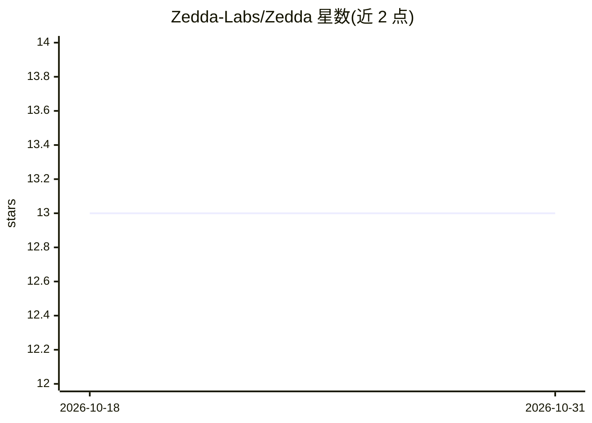

# Zedda-Labs/Zedda

⭐ 13 · Python · MIT · 推送 2026-10-29 · [GitHub](https://github.com/Zedda-Labs/Zedda) · [官网](https://zedda-labs.github.io/Zedda-Documentation/) · 组织维护

**Python EDA/数据清洗引擎，C++ 内核流式单遍扫描数据集**

以 C++17 编写核心的 Python 数据剖析与清洗库：一次调用即可完成 profile、clean、validate、scan，流式处理保持常数内存，从 900 行 CSV 到 TB 级 Parquet 用法一致。清洗操作确定性且原子化：自动备份、输出审计 JSON、支持一键回滚；ID 列/零方差/离群点/多重共线性按单遍统计规则判定。可接受文件路径或 pandas DataFrame，提供 CLI 与自包含 HTML 报告（无外部网络调用）。AI 问答（zd.ask）为可选 extra，接 Groq/OpenAI。

## 筛选速览

| 维度 | 判定 | 备注 |
|---|---|---|
| AI 角色 | `ai-enhanced` | 去掉 AI 部分产品仍成立 |
| 许可风险 | `permissive` | MIT |
| 部署形态 | `library` | 以包/库形式分发 |
| 模型依赖 | — | README 未给出锁定关系 |
| 硬件要求 | — | 无带数字的原话,不猜 |
| 安装摩擦 | `medium` | 含编译或系统依赖之一 |
| 成熟度 | — | 结构信号不足 |

## 能力要点

- C++17 内核流式单遍扫描，常数内存处理 TB 级数据
- zd.clean() 自动备份 + 审计 JSON + 回滚（zd.clean.undo）
- 预编译 wheel 覆盖 Linux/macOS/Windows 主流架构（x86_64 与 ARM64）
- 自包含 HTML 报告（零 CDN/零追踪），可离线合规环境使用

## 适用场景

- 对大型 CSV/Parquet 数据集做单遍探索性分析（EDA）
- 在数据接入流水线中自动化清洗并保留审计记录
- 在 CI/CD 中用 CLI 输出结构化 JSON 做数据质量检查
- 银行/医疗等隔离网络环境生成离线数据质量报告

## 场景标签

`数据分析` · 领域:效率与自动化

## 证据(README 行号)

> L7: C++17-powered EDA and data cleaning engine for Python.
> L23: Zedda profiles, cleans, and validates datasets from a single Python call.
> L35: pip install "zedda[ai]"                    # adds AI Q&A (zd.ask with Groq/OpenAI)

## 星数曲线

2026-10-18 13 → 2026-10-31 13（+0）

---
*卡片 v1 · prompt 1.4 · 生成 2026-10-31 · 置信度 high · 依据 README sha `e3c1e2d2caa5` · [字段定义](../../DATASET.md)*
