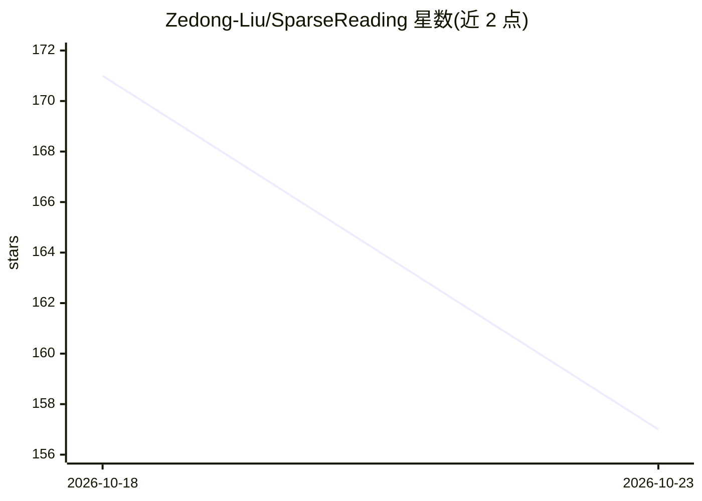

# Zedong-Liu/SparseReading

⭐ 157 · Python · MIT · 推送 2026-10-21 · [GitHub](https://github.com/Zedong-Liu/SparseReading) · [官网](https://zedong-liu.github.io/SparseReading/) · 个人维护 · 中文 README

**给工具型 AI agent 的免训练稀疏阅读层：少读省 token 保证据**

SparseRead 是位于 agent 原生读取工具之前的控制层（training-free）：通过 Read Gate 按工件形态与任务收益选择 auto/native/advisory 行为，Reader Backend 产出有界视图，EvidencePack 返回带来源锚点的紧凑证据，支持预览、定向读取、精炼、校验与显式原生回退。面向 Claude Code、OpenCode、OpenClaw、NanoBot、Codex、Pi 等框架提供适配器，以源码安装器分发（PyPI/npm 尚未发布），需 Python 3.11+、uv、Node.js 22+。论文报告 125 任务、6 模型评估，最高 token 缩减 92.9%。

## 筛选速览

| 维度 | 判定 | 备注 |
|---|---|---|
| AI 角色 | `ai-ecosystem` | LLM/agent 周边工具 |
| 许可风险 | `permissive` | MIT |
| 部署形态 | `library` | 以包/库形式分发 |
| 模型依赖 | locked-api |  |
| 硬件要求 | — | 无带数字的原话,不猜 |
| 安装摩擦 | `low` | 无编译、无系统依赖或容器化 |
| 成熟度 | `idea` | |

## 能力要点

- Read Gate 自动在原生读取与稀疏读取间决策，小文件/低收益场景留在原生工具
- EvidencePack 携带来源锚点、未满足需求与下一步建议，支持显式 raw fallback
- 6 个 agent 框架适配器（Claude Code/OpenCode/OpenClaw/NanoBot/Codex/Pi）
- 论文评估 125 任务、6 个前沿模型，最高 token 缩减 92.9%、耗时缩减 89.0%

## 适用场景

- agent 处理长报告、PDF、多文件工作区时控制上下文成本
- 在 Claude Code / OpenCode 等框架中用稀疏读取替代全量 read
- 需要保留证据来源锚点的长文档审计任务

## 场景标签

 · 领域:LLM 基础设施/上下文管理

## 证据(README 行号)

> L29: multi-file audits. SparseRead adds a small control plane in front of native
> L158: - **Read Gate** — selects `auto`, `native`, or `advisory` behavior from artifact
> L161: - **Reader Backends** — provide typed, bounded views for text/PDF, structured

## 星数曲线

2026-10-18 171 → 2026-10-23 157（-14）

---
*卡片 v1 · prompt 1.4 · 生成 2026-10-23 · 置信度 mid · 依据 README sha `935ae203f384` · [字段定义](../../DATASET.md)*
