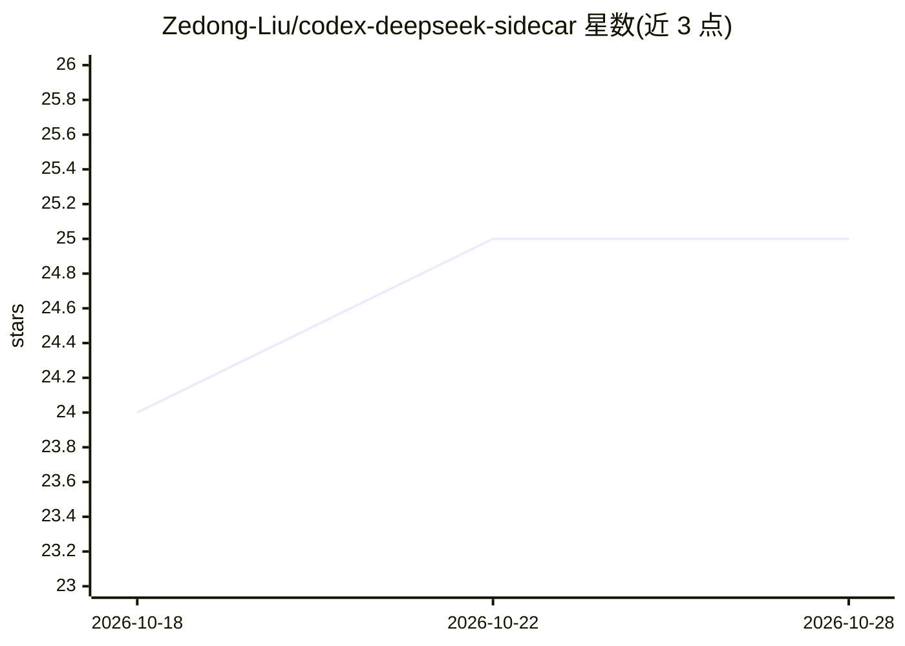

# Zedong-Liu/codex-deepseek-sidecar

⭐ 25 · Python · NOASSERTION · 推送 2026-10-20 · [GitHub](https://github.com/Zedong-Liu/codex-deepseek-sidecar) · 个人维护 · 中文 README

**Codex skill：让 GPT 主脑把子任务派给 DeepSeek 工人 agent**

面向 Codex CLI 的 skill：主 agent（GPT）负责规划判断，把长测试、日志分析、大范围代码探索等边界清晰的子任务分派给成本更低的 DeepSeek sidecar 工人 agent，所有会话仍在 Codex harness 内运转并跟踪 task/session。传输层分两路：Flash profile 直连 DeepSeek 官方 Responses API（凭据走 macOS Keychain）；Pro/Beta 使用仓库内置的 Python 轻量代理桥接。另提供 Claude Code 与 OpenCode 适配器，Python 3 与 DeepSeek API key 为前提。

## 筛选速览

| 维度 | 判定 | 备注 |
|---|---|---|
| AI 角色 | `ai-ecosystem` | LLM/agent 周边工具 |
| 许可风险 | `none` | NOASSERTION |
| 部署形态 | `None` |  |
| 模型依赖 | locked-api |  |
| 硬件要求 | — | 无带数字的原话,不猜 |
| 安装摩擦 | `low` | 无编译、无系统依赖或容器化 |
| 成熟度 | — | 结构信号不足 |

## 能力要点

- 一句话 prompt 即可让 Codex 安装并启动 DeepSeek sidecar
- Flash 直连官方 Responses API，Pro/Beta 走内置本地代理
- sidecar 保持 Codex 的文件访问、命令执行与会话跟踪能力
- 附 Claude Code 与 OpenCode 适配器

## 适用场景

- 把跑慢测试、CI 日志分析交给便宜的 DeepSeek 工人并行处理
- 让主 agent 自动分派 token 消耗大的重复执行类任务
- 在 Codex/Claude Code/OpenCode 中按 profile 切换强弱工人模型

## 场景标签

`编码 Agent` `多智能体` · 领域:Agent 开发

## 证据(README 行号)

> L11: `codex-deepseek-sidecar` 是一个 Codex skill，让你的主 agent 可以把边界清晰的子任务——长测试、日志分析、大范围代码探索、独立 review、实现尝试——派给更便宜的 DeepSeek 工
> L13: 核心模式很简单：高级 GPT 继续做主脑，负责规划、判断和综合；DeepSeek 工人处理重复、长上下文、token-heavy 的执行工作；所有事情仍然在 Codex harness 里运转。

## 星数曲线

2026-10-18 24 → 2026-10-28 25（+1）

---
*卡片 v1 · prompt 1.4 · 生成 2026-10-27 · 置信度 high · 依据 README sha `c79dc3d38925` · [字段定义](../../DATASET.md)*
