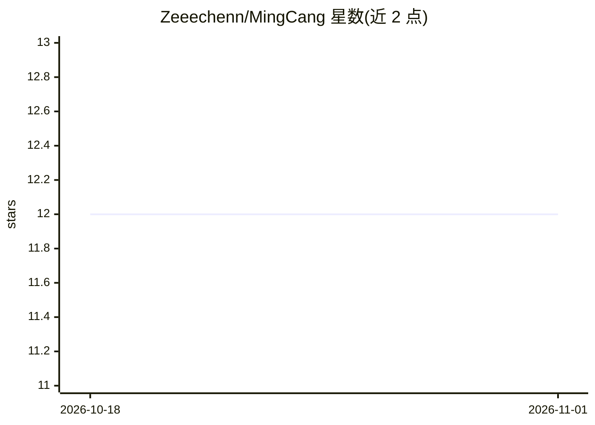

# Zeeechenn/MingCang

⭐ 12 · Python · NOASSERTION · 推送 2026-09-24 · [GitHub](https://github.com/Zeeechenn/MingCang) · [官网](https://zeeechenn.github.io/MingCang/) · 个人维护 · 中文 README

**本地优先的个人 A 股研究 Agent 工作台，人做决策、AI 做证伪**

面向个人投资者的本地优先 A 股研究系统：以自然语言 Agent 为主要入口，覆盖个股研究、每日信号与 ATR 风险线、盘前/盘后扫描、纸上交易、复盘归因与记忆系统；另提供 FastAPI 后端与本地 Web 工作台（当前仍在产品化打磨）。数据默认存本地 SQLite，LLM 层定位于研究裁量与反方审视，不自动下单、不修改官方信号，记忆默认影子模式。许可证为 PolyForm Noncommercial，禁止未授权商业使用。

## 筛选速览

| 维度 | 判定 | 备注 |
|---|---|---|
| AI 角色 | `ai-native` | 本体是模型或模型工具 |
| 许可风险 | `none` | NOASSERTION |
| 部署形态 | `self-host` | docker 或自建部署 |
| 模型依赖 | locked-api |  |
| 硬件要求 | — | 无带数字的原话,不猜 |
| 安装摩擦 | `low` | 无编译、无系统依赖或容器化 |
| 成熟度 | `idea` | |

## 能力要点

- 自然语言 Agent 统一研究、扫描、复盘与记忆查询入口
- 每日信号由技术因子、新闻情感、质量旗标与 ATR 移动止损构成
- 案卷式闭环：判断→信号→持仓→复盘→记忆可链接可审计
- 多源数据底座含防未来函数、质量门与缓存新鲜度契约
- 零云端 key 可跑基础流程（依赖本机已登录的 AI CLI）

## 适用场景

- 用对话完成单股研究与盘前风险扫描
- 盘后复盘信号与持仓，把亏损归因沉淀为规则
- 长期跟踪赛道论题并记录失效条件
- 纸上交易验证研究流程与风险纪律

## 场景标签

`金融量化` · 领域:学习与行业

## 证据(README 行号)

> L3: > **本地优先的 A 股研究 Agent**：把研究、信号、持仓纪律、复盘和记忆串成一套可对话的个人研究工作台。
> L21: - **研究入口**：你用自然语言提问，明仓自己调度本地研究、信号和风险上下文；历史记忆只在你明确查询时返回。
> L104: |Agent 对话入口|把股票研究、关注列表、日常扫描、复盘和记忆查询统一成自然语言交互。|

## 星数曲线

2026-10-18 12 → 2026-11-01 12（+0）

---
*卡片 v1 · prompt 1.4 · 生成 2026-11-01 · 置信度 high · 依据 README sha `7c1afe3163df` · [字段定义](../../DATASET.md)*
