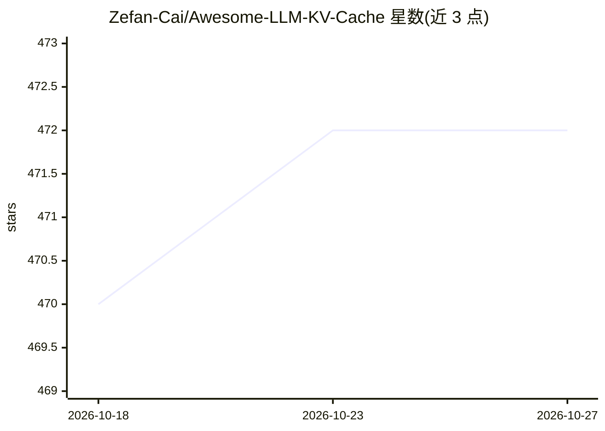

# Zefan-Cai/Awesome-LLM-KV-Cache

⭐ 472 · GPL-3.0 · 推送 2026-06-17 · [GitHub](https://github.com/Zefan-Cai/Awesome-LLM-KV-Cache) · 个人维护

**LLM KV Cache 论文与代码策展清单（10+ 类）**

个人维护的 LLM KV Cache 论文聚合清单，按主题分类组织：趋势推理话题、KV Cache 压缩、合并、预算分配、查询感知检索、跨层利用、量化、低秩分解、观测与评测基准等。每条目含日期、论文标题、PDF 链接、代码仓库链接与推荐星级，部分附方法注释（如层级预算分配、注意力选择）。收录 DeepSeek-V2、YOCO、Mooncake、StreamingLLM、KVQuant 等论文。仅供学习与分类查阅，不提供安装运行。

## 筛选速览

| 维度 | 判定 | 备注 |
|---|---|---|
| AI 角色 | `ai-knowledge` | 知识聚合/清单类 |
| 许可风险 | `viral` | GPL-3.0 |
| 部署形态 | `None` |  |
| 模型依赖 | — | README 未给出锁定关系 |
| 硬件要求 | — | 无带数字的原话,不猜 |
| 安装摩擦 | `low` | 无编译、无系统依赖或容器化 |
| 成熟度 | — | 结构信号不足 |

## 能力要点

- 按压缩/合并/量化/预算分配/评测等 10+ 主题分类
- 条目含论文 PDF 链接与代码仓库链接
- 推荐星级与方法注释标注

## 适用场景

- 查找 KV Cache 压缩与量化方向的论文及代码
- 了解 KV Cache 研究的分类体系与代表工作
- 查阅长上下文评测基准论文

## 场景标签

`精选清单` · 领域:学习与行业

## 证据(README 行号)

> L2: Awesome-LLM-KV-Cache: A curated list of 📙Awesome LLM KV Cache Papers with Codes. This repository is for personal use
> L6: ## 📖Contents

## 星数曲线

2026-10-18 470 → 2026-10-27 472（+2）

---
*卡片 v1 · prompt 1.4 · 生成 2026-10-22 · 置信度 high · 依据 README sha `35be391d00a1` · [字段定义](../../DATASET.md)*
