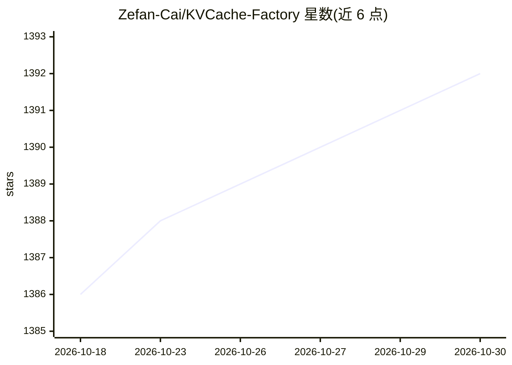

# Zefan-Cai/KVCache-Factory

⭐ 1,392 · Python · MIT · 推送 2026-08-13 · [GitHub](https://github.com/Zefan-Cai/KVCache-Factory) · 组织维护

**面向长上下文 LLM 推理的 KV 缓存压缩方法统一评测框架**

从 PyramidKV 项目扩展而来的统一实验平台，将 18 种以上 KV cache 压缩、检索、合并与量化方法（StreamingLLM、H2O、SnapKV、PyramidKV、HeadInfer、KIVI/KVQuant/GEAR 等）聚合到同一评测接口下。提供 LongBench、Needle-in-a-haystack、RULER 三类评测 runner 及延迟/显存基准脚本，支持多 GPU 推理与 Llama、Mistral 注意力路径。transformers 版本锁定 4.44.2，评测 batch size 须为 1，部分新方法模型覆盖较窄。

## 筛选速览

| 维度 | 判定 | 备注 |
|---|---|---|
| AI 角色 | `ai-ecosystem` | LLM/agent 周边工具 |
| 许可风险 | `permissive` | MIT |
| 部署形态 | `library` | 以包/库形式分发 |
| 模型依赖 | — | README 未给出锁定关系 |
| 硬件要求 | — | 无带数字的原话,不猜 |
| 安装摩擦 | `low` | 无编译、无系统依赖或容器化 |
| 成熟度 | — | 结构信号不足 |

## 能力要点

- 统一接口聚合 18+ 种 KV cache 压缩/检索/合并/量化方法
- LongBench、Needle-in-a-haystack、RULER 三类评测 runner
- HeadInfer 无损 head 级 CPU offload，可在单 GPU 上跑数十万 token
- 每次运行写入含 git commit 与参数的 run_meta.json 以保证可复现

## 适用场景

- 在同一评测接口下对比不同 KV cache 压缩方法的精度
- 长上下文推理场景下测试不同缓存预算的延迟与显存
- 复现 PyramidKV/HeadInfer 等论文的 LongBench 与大海捞针结果

## 场景标签

`模型评测` · 领域:评测与运维

## 证据(README 行号)

> L5: KVCache-Factory is a unified playground for KV cache compression, retrieval, merging, and quantization methods for l
> L13: ## Supported Methods
> L83: python3 run_longbench.py \

## 星数曲线

2026-10-18 1,386 → 2026-10-30 1,392（+6）

---
*卡片 v1 · prompt 1.4 · 生成 2026-10-21 · 置信度 mid · 依据 README sha `0bfd2721ab68` · [字段定义](../../DATASET.md)*
