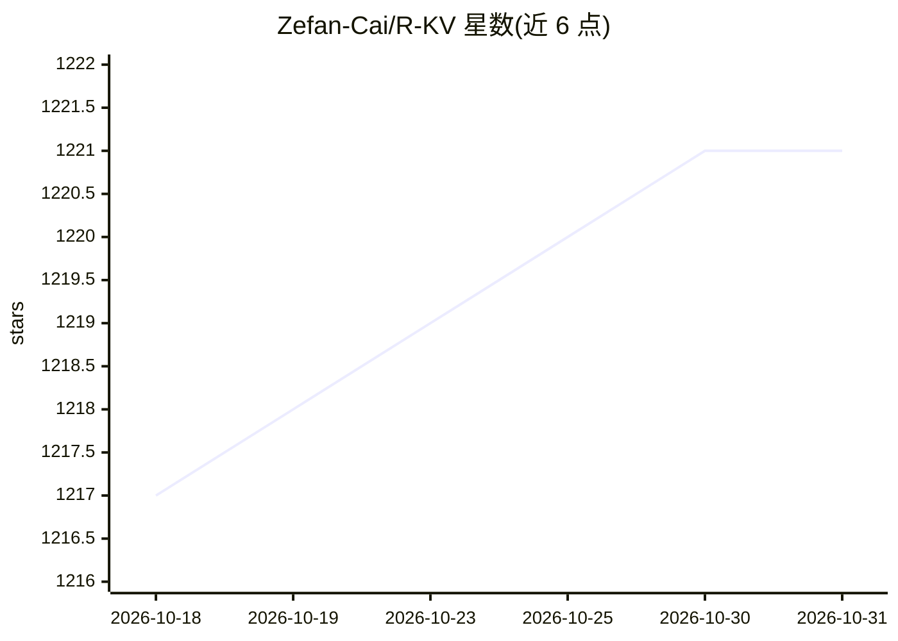

# Zefan-Cai/R-KV

⭐ 1,221 · Python · 推送 2026-10-18 · [GitHub](https://github.com/Zefan-Cai/R-KV) · [官网](https://zefan-cai.github.io/R-KV.page/) · 个人维护

**面向推理模型的冗余感知 KV 缓存压缩方法，降显存提吞吐**

NeurIPS 2025 论文 R-KV 的官方实现：在解码时对新生成的 token 先入缓冲区，再用注意力权重做重要性评分、用 key 向量余弦相似度估计冗余，仅保留重要且非冗余的 token，从而压缩推理模型的 KV 缓存。免训练，可包装任意自回归 LLM。提供 HuggingFace 参考实现及 vLLM、SGLang、Nano-vLLM、Mini-SGLang 四种 serving 集成（patch-not-fork 布局），并附 CPU 单测、GPU 冒烟测试与基准复现脚本；vLLM 端源码构建需 CUDA 与 GPU。

## 筛选速览

| 维度 | 判定 | 备注 |
|---|---|---|
| AI 角色 | `ai-ecosystem` | LLM/agent 周边工具 |
| 许可风险 | `none` | — |
| 部署形态 | `library` | 以包/库形式分发 |
| 模型依赖 | local-ok | 支持本地模型 |
| 硬件要求 | — | 无带数字的原话,不猜 |
| 安装摩擦 | `medium` | 含编译或系统依赖之一 |
| 成熟度 | — | 结构信号不足 |

## 能力要点

- 解码时按重要性+非冗余双维度排序并丢弃重复 token，免训练
- 提供 vLLM/SGLang/Nano-vLLM/Mini-SGLang 四种 serving 集成与复现基准
- CPU 单测覆盖算法本体并在 CI 中运行，GPU 冒烟测试覆盖四条集成路径
- README 报告 10% 缓存保留约 100% 精度、90% 显存节省、6.6 倍吞吐（论文口径数据）

## 适用场景

- 推理模型长 CoT 生成时压缩 KV 缓存以省显存
- 在 vLLM/SGLang 服务中启用 KV 压缩提升并发与吞吐
- 复现论文的数学推理基准评估结果

## 场景标签

`推理引擎` · 领域:训练与推理

## 证据(README 行号)

> L159: Large language models that rely on chain-of-thought (CoT) or self-reflection can crack tough reasoning tasks—but a
> L184: - **Plug-and-play:** a lightweight wrapper for any autoregressive LLM
> L200: Redundancy-aware KV Cache Compression for R1-Style models (i.e., **R-KV**) is the first production-level KV Cache 

## 星数曲线

2026-10-18 1,217 → 2026-10-31 1,221（+4）

---
*卡片 v1 · prompt 1.4 · 生成 2026-10-21 · 置信度 high · 依据 README sha `ae8fbc229538` · [字段定义](../../DATASET.md)*
