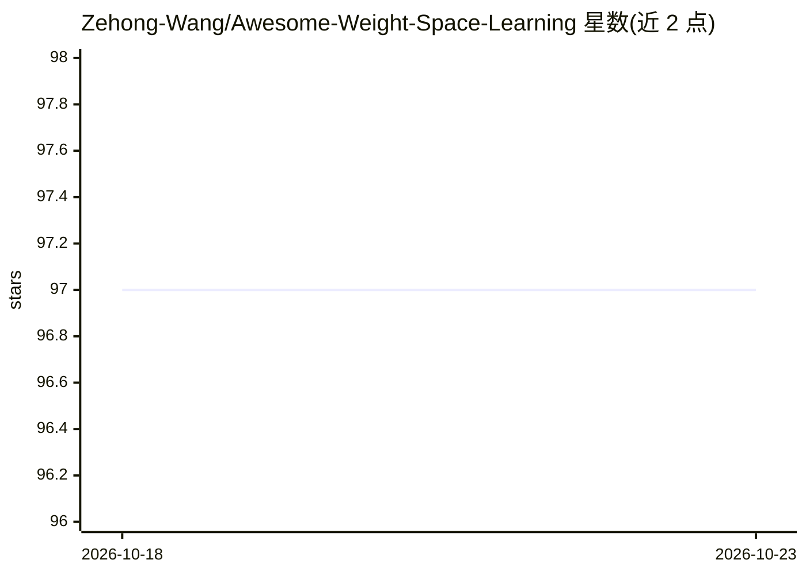

# Zehong-Wang/Awesome-Weight-Space-Learning

⭐ 97 · MIT · 推送 2026-05-12 · [GitHub](https://github.com/Zehong-Wang/Awesome-Weight-Space-Learning) · 个人维护

**权重空间学习论文/代码/数据集的策展清单，面向科研者**

以综述形式组织的 weight space learning 资源仓库：收录该方向的论文、代码库与基准数据集，按权重空间理解（几何、对称性、统计性质）、权重空间判别（嵌入、检索、行为预测）、权重空间生成（生成模型、超网络、模型合并）三个维度分类展开。每个维度下再按研究主题（不变性、等变性、模型压缩、超网络等）细分条目，条目含会议标签及 PDF/代码链接。仓库声明持续更新，面向从事神经网络参数研究的科研人员。

## 筛选速览

| 维度 | 判定 | 备注 |
|---|---|---|
| AI 角色 | `ai-knowledge` | 知识聚合/清单类 |
| 许可风险 | `permissive` | MIT |
| 部署形态 | `None` |  |
| 模型依赖 | — | README 未给出锁定关系 |
| 硬件要求 | — | 无带数字的原话,不猜 |
| 安装摩擦 | `low` | 无编译、无系统依赖或容器化 |
| 成熟度 | — | 结构信号不足 |

## 能力要点

- 按理解/判别/生成三维度组织的论文分类体系
- 覆盖不变性、等变性、模型检索、超网络、权重生成等十余个主题
- 多数条目附 PDF 与代码链接

## 适用场景

- 查找权重空间学习方向的论文与代码
- 按研究主题梳理超网络、模型检索等子领域工作
- 为该方向综述写作收集文献

## 场景标签

`精选清单` `科研工具` · 领域:学习与行业

## 证据(README 行号)

> L4: > A curated survey-style repository for papers, codebases, and benchmarks on weight space learning.
> L14: Weight Space Learning is a research perspective that shifts focus from studying neural networks only through their 

## 星数曲线

2026-10-18 97 → 2026-10-23 97（+0）

---
*卡片 v1 · prompt 1.4 · 生成 2026-10-23 · 置信度 high · 依据 README sha `c64076165c62` · [字段定义](../../DATASET.md)*
