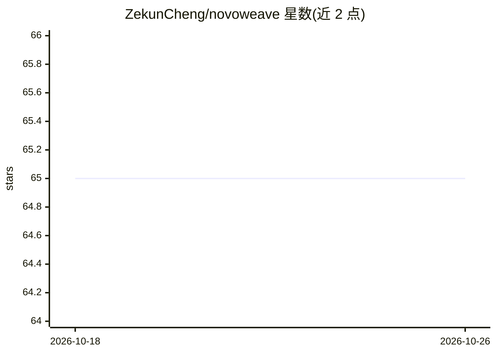

# ZekunCheng/novoweave

⭐ 65 · Python · MIT · 推送 2026-09-02 · [GitHub](https://github.com/ZekunCheng/novoweave) · 个人维护

**生成式蛋白质设计框架的概念性设计蓝图（非功能伪代码）**

面向蛋白质设计研究者的软件架构蓝图：将骨架生成、序列设计、评估与来源记录组织为四个可替换阶段（扩散式几何模型接口、结构条件 transformer 接口、指标契约、多目标排序），以类型化 Python 包与契约测试形式呈现，供讨论系统设计。明确声明不含训练权重、张量内核、损失函数与基准结果，已实现部分仅限配置/数据契约与工具链，命令行用法仅为示意。

## 筛选速览

| 维度 | 判定 | 备注 |
|---|---|---|
| AI 角色 | `ai-ecosystem` | LLM/agent 周边工具 |
| 许可风险 | `permissive` | MIT |
| 部署形态 | `library` | 以包/库形式分发 |
| 模型依赖 | — | README 未给出锁定关系 |
| 硬件要求 | — | 无带数字的原话,不猜 |
| 安装摩擦 | `low` | 无编译、无系统依赖或容器化 |
| 成熟度 | `idea` | |

## 能力要点

- 四阶段概念流水线：骨架生成/序列设计/评估/排序的可替换接口
- 已实现部分限于配置与数据契约、边界校验、日志约定及仓库工具
- 设计原则含可复现性（记录配置/代码版本/种子）与无自主湿实验交接

## 适用场景

- 在动手实现前讨论蛋白质设计系统的架构与接口划分
- 教学或设计讨论中作为端到端深度学习工作流蓝本的参考
- 按路线图规划假设性的功能实现顺序

## 场景标签

 · 领域:计算生物学/蛋白质设计

## 证据(README 行号)

> L8: **A conceptual generative protein-design framework.** NovoWeave is a
> L32: 1. **Backbone proposal** — a diffusion-style geometric model interface.
> L68: This is a **conceptual scaffold / design document in code form**, not a model

## 星数曲线

2026-10-18 65 → 2026-10-26 65（+0）

---
*卡片 v1 · prompt 1.4 · 生成 2026-10-24 · 置信度 high · 依据 README sha `d11bb430941a` · [字段定义](../../DATASET.md)*
