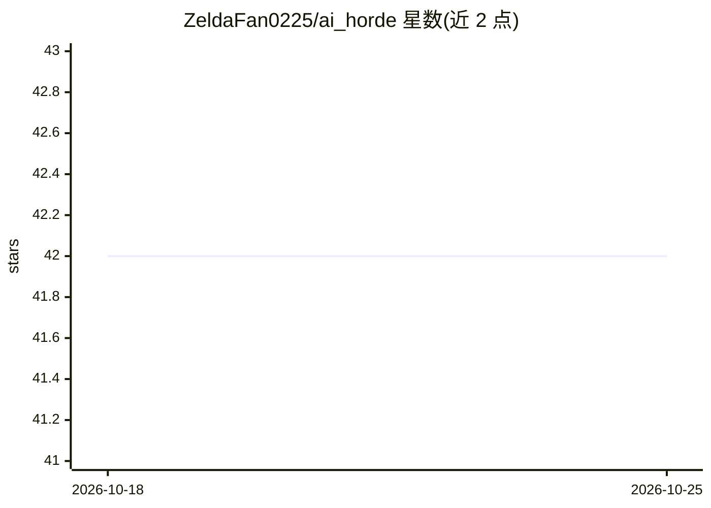

# ZeldaFan0225/ai_horde

⭐ 42 · TypeScript · MIT · 推送 2026-10-10 · [GitHub](https://github.com/ZeldaFan0225/ai_horde) · 个人维护

**与 AI Horde API 交互的 Node.js/TypeScript 客户端库**

npm 包，封装 AI Horde API（众包分布式 AI 图像生成服务）的通信：导出 AIHorde 类，提供 API V2 全部端点的方法、可配置缓存、默认 Token 与带注释的 TypeScript 类型，并导出请求负载使用的常量。面向在 Node.js（18.0.0 及以上）中接入 AI Horde 的开发者。声明与 AI Horde 创作者无关联，尚缺速率限制桶功能；发布通过 GitHub Action 自动执行并带 npm provenance。

## 筛选速览

| 维度 | 判定 | 备注 |
|---|---|---|
| AI 角色 | `ai-ecosystem` | LLM/agent 周边工具 |
| 许可风险 | `permissive` | MIT |
| 部署形态 | `None` |  |
| 模型依赖 | — | README 未给出锁定关系 |
| 硬件要求 | — | 无带数字的原话,不猜 |
| 安装摩擦 | `low` | 无编译、无系统依赖或容器化 |
| 成熟度 | — | 结构信号不足 |

## 能力要点

- 覆盖 AI Horde API V2 全部端点的方法
- 可配置缓存与默认 Token
- 带注释与说明的 TypeScript 类型定义

## 适用场景

- 在我的 Node.js 项目中调用 AI Horde 生成图像
- 使用 TypeScript 类型安全地接入 AI Horde API
- 构建基于 AI Horde 众包算力的图像生成应用

## 场景标签

`图像生成` · 领域:内容生成

## 证据(README 行号)

> L10: This package allows you to communicate with the AI Horde API
> L40: - Methods for all endpoints on the API V2

## 星数曲线

2026-10-18 42 → 2026-10-25 42（+0）

---
*卡片 v1 · prompt 1.4 · 生成 2026-10-25 · 置信度 high · 依据 README sha `6e2f38258d35` · [字段定义](../../DATASET.md)*
