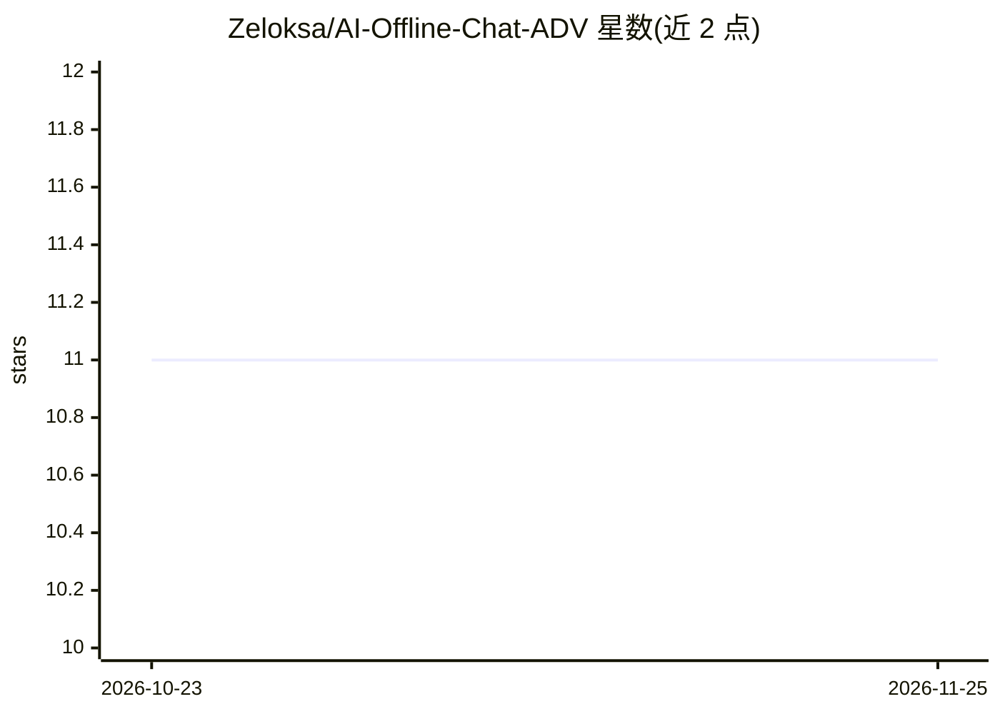

# Zeloksa/AI-Offline-Chat-ADV

⭐ 11 · 推送 2026-11-11 · [GitHub](https://github.com/Zeloksa/AI-Offline-Chat-ADV) · [官网](https://boosty.to/zeloksa) · 个人维护

**M5Stack Cardputer 上的完全离线 ELIZA 心理陪伴固件**

为 M5Stack Cardputer（ESP32-S3）开发的固件，本地运行自定义自然语言引擎，复刻 1966 年 MIT 的 ELIZA 罗杰斯式心理治疗模拟：监听用户输入、识别俚语/错字/否定句、追踪情绪状态（9 种临床状态）与人际关系图谱，并在屏幕上渲染程序化眼睛动画、脑电波与心率图表。100% 离线运行，无 Wi-Fi 与云端 API。源码闭源，仅通过浏览器烧录工具或 .bin 文件分发，持久化记忆需插入 FAT32 MicroSD 卡。

## 筛选速览

| 维度 | 判定 | 备注 |
|---|---|---|
| AI 角色 | `ai-native` | 本体是模型或模型工具 |
| 许可风险 | `none` | — |
| 部署形态 | `None` |  |
| 模型依赖 | — | README 未给出锁定关系 |
| 硬件要求 | — | 无带数字的原话,不猜 |
| 安装摩擦 | `low` | 无编译、无系统依赖或容器化 |
| 成熟度 | — | 结构信号不足 |

## 能力要点

- 自然语言引擎完全在 ESP32-S3 本地运行，无云端调用
- 情绪与人际关系追踪：9 种临床状态、社交依恋图（-10..+10）、潜意识记忆
- 程序化眼睛动画支持光标追踪、眨眼、多种情绪状态
- MicroSD 卡持久化保存用户档案与聊天历史

## 适用场景

- 在没有网络的离线设备上进行倾诉式对话
- 作为 Cardputer 设备上的复古风格陪伴应用
- 体验 ELIZA 型心理治疗模拟与现代情绪追踪机制

## 场景标签

`聊天机器人` · 领域:对话与助手

## 证据(README 行号)

> L9: **AI Offline Chat ADV** is a modern, fully autonomous offline remake of **ELIZA** - the world's first psychological 
> L17: **This is NOT ChatGPT.** Please understand what you are installing:
> L44: ### 🧠 Smarter Offline Language & Psychology

## 星数曲线

2026-10-23 11 → 2026-11-25 11（+0）

---
*卡片 v1 · prompt 1.4 · 生成 2026-11-18 · 置信度 high · 依据 README sha `2d1f558f4341` · [字段定义](../../DATASET.md)*
