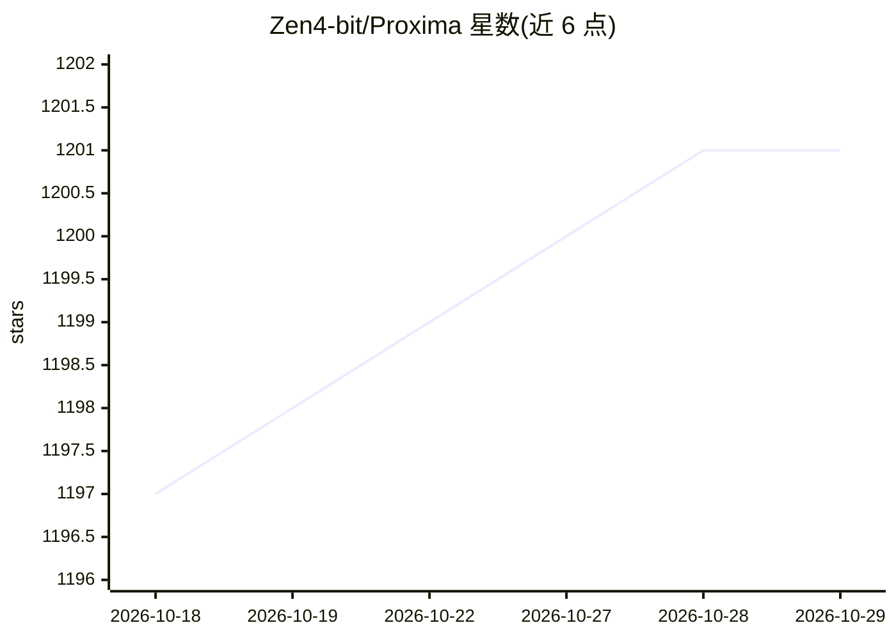

# Zen4-bit/Proxima

⭐ 1,201 · JavaScript · NOASSERTION · 推送 2026-10-16 · [GitHub](https://github.com/Zen4-bit/Proxima) · [官网](https://www.proximamcp.in/) · 个人维护

**本地 MCP 网关：把浏览器登录的网页模型与本地模型接入编码工具**

Electron 桌面应用，作为本地开发网关在 127.0.0.1 聚合多种模型来源，供 Cursor、VS Code、Windsurf、Claude Desktop 等 MCP 客户端调用。两种路由模式：Session 模式复用 ChatGPT/Claude/Gemini/Perplexity 的已登录浏览器会话，无需 API key（README 自述可能不符合部分服务商 ToS）；BYOK 模式支持 OpenAI、Anthropic、DeepSeek、Groq 等官方 key 及 Ollama/LM Studio 本地引擎。附带 Python 编写的 proxima-agent，具备自愈调试、浏览器控制与 SQLite 跨会话记忆。许可证为 Non-Commercial。

## 筛选速览

| 维度 | 判定 | 备注 |
|---|---|---|
| AI 角色 | `ai-ecosystem` | LLM/agent 周边工具 |
| 许可风险 | `none` | NOASSERTION |
| 部署形态 | `desktop` | 安装包/桌面程序 |
| 模型依赖 | local-ok | 支持本地模型 |
| 硬件要求 | — | 无带数字的原话,不猜 |
| 安装摩擦 | `low` | 无编译、无系统依赖或容器化 |
| 成熟度 | — | 结构信号不足 |

## 能力要点

- Session 模式通过渲染层拦截 WebSocket/API 流复用已登录浏览器会话，无需 API key
- BYOK 模式支持 OpenAI/Anthropic/Google/DeepSeek/Groq/xAI/OpenRouter 等及 Ollama/LM Studio 本地引擎
- 内置自愈调试循环、CDP 浏览器控制与动态技能生成的 Python agent
- 四个 SQLite 本地数据库实现会话谱系、经验学习与程序性技能管理

## 适用场景

- 在 Cursor/VS Code 等编辑器中调用多个前沿模型而不购买 API 订阅
- 通过 Ollama/LM Studio 完全本地运行模型保护代码隐私
- 让 agent 自动定位 bug、修改代码并运行测试直至通过

## 场景标签

`模型网关` · 领域:Agent 开发

## 证据(README 行号)

> L7: **Run frontier LLMs directly inside Cursor, VS Code, Windsurf, or Claude Desktop using free browser login sessions o
> L39: Proxima serves as a local development gateway that centralizes and runs all your AI models together on `127.0.0.1`.

## 星数曲线

2026-10-18 1,197 → 2026-10-29 1,201（+4）

---
*卡片 v1 · prompt 1.4 · 生成 2026-10-21 · 置信度 mid · 依据 README sha `dfa462276670` · [字段定义](../../DATASET.md)*
