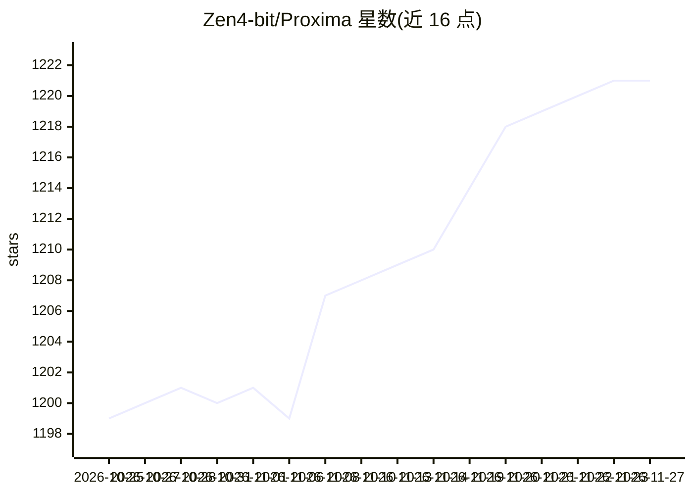

# Zen4-bit/Proxima

⭐ 1,221 · JavaScript · NOASSERTION · 推送 2026-11-25 · [GitHub](https://github.com/Zen4-bit/Proxima) · [官网](https://www.proximamcp.in/) · 个人维护

**将网页版 AI 会话接入本地 MCP 服务器的开发网关**

本地桌面网关（127.0.0.1），把 ChatGPT、Claude、Gemini、Perplexity 的登录浏览器会话转换为标准 MCP 端点，供 Cursor、VS Code、Windsurf、Claude Desktop 等开发工具调用，无需 API key；另提供 BYOK 模式接入多家 API 与 Ollama/LM Studio 本地模型。附带 Python agent，支持自愈调试循环、CDP 浏览器控制、动态技能生成，并用四个 SQLite 库维护跨会话记忆。许可证为 Non-Commercial，Session 模式自动浏览器会话可能超出部分服务商服务条款。

## 筛选速览

| 维度 | 判定 | 备注 |
|---|---|---|
| AI 角色 | `ai-ecosystem` | LLM/agent 周边工具 |
| 许可风险 | `none` | NOASSERTION |
| 部署形态 | `desktop` | 安装包/桌面程序 |
| 模型依赖 | local-ok | 支持本地模型 |
| 硬件要求 | — | 无带数字的原话,不猜 |
| 安装摩擦 | `low` | 无编译、无系统依赖或容器化 |
| 成熟度 | — | 结构信号不足 |

## 能力要点

- Session Routing 复用已登录浏览器会话，无需 API key
- BYOK 模式支持 OpenAI、Anthropic、DeepSeek、Groq、OpenRouter 等多服务商
- Python agent 具备自愈调试、CDP 浏览器控制与动态技能生成
- 四个本地 SQLite 库提供跨会话记忆与技能管理

## 适用场景

- 不购买 API 订阅，让 Cursor 通过 MCP 调用网页版模型
- 用本地 Ollama 模型为编辑器 agent 提供推理后端
- 让 Python agent 自动修 bug 并跑通测试
- 在开发工具中统一接入多家模型服务

## 场景标签

`模型网关` · 领域:Agent 开发

## 证据(README 行号)

> L7: **Run frontier LLMs directly inside Cursor, VS Code, Windsurf, or Claude Desktop using free browser login sessions o
> L39: Proxima serves as a local development gateway that centralizes and runs all your AI models together on `127.0.0.1`.

## 星数曲线

2026-10-25 1,199 → 2026-11-27 1,221（+22）

---
*卡片 v1 · prompt 1.4 · 生成 2026-11-23 · 置信度 mid · 依据 README sha `81f89f0144e1` · [字段定义](../../DATASET.md)*
