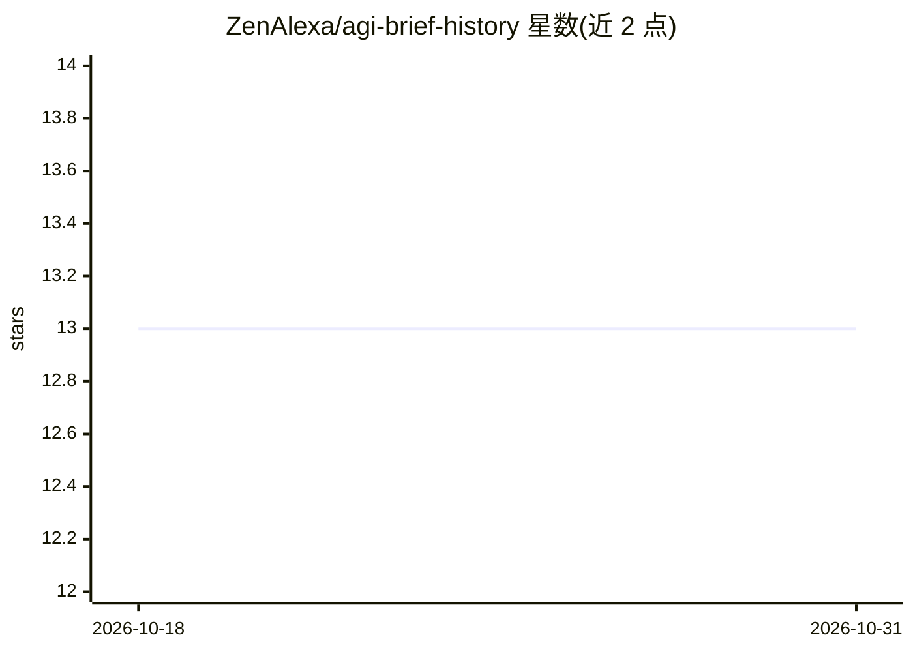

# ZenAlexa/agi-brief-history

⭐ 13 · TeX · MIT · 推送 2026-10-01 · [GitHub](https://github.com/ZenAlexa/agi-brief-history) · 个人维护 · 中文 README

**AGI 知识体系仓库：原创书籍、结构化知识库与生态自动追踪**

面向开源大模型时代的系统性知识工程项目：包含 5 本原创 LaTeX 书籍/报告（98,000+ 行），覆盖技术演进、AI 创业版图、关键人物、具身智能与 LLM 核心技术速查，可下载 PDF 并接受 PR；结构化知识库按推理、预训练、后训练、数据等 7 大领域组织，以 Git 子模块追踪 16 个核心开源项目；GitHub Actions 每日生成 ArXiv 论文摘要、每周更新排行榜快照与综合周报。中英双语，MIT 许可。

## 筛选速览

| 维度 | 判定 | 备注 |
|---|---|---|
| AI 角色 | `ai-knowledge` | 知识聚合/清单类 |
| 许可风险 | `permissive` | MIT |
| 部署形态 | `None` |  |
| 模型依赖 | — | README 未给出锁定关系 |
| 硬件要求 | — | 无带数字的原话,不猜 |
| 安装摩擦 | `low` | 无编译、无系统依赖或容器化 |
| 成熟度 | — | 结构信号不足 |

## 能力要点

- 5 本原创 LaTeX 书籍/报告（98,000+ 行），提供 PDF 下载
- 结构化知识库覆盖 LLM 生命周期 7 大领域
- 16 个核心开源项目以 Git 子模块实时追踪
- GitHub Actions 自动化每日 ArXiv 摘要与每周排行榜快照

## 适用场景

- 系统学习从 Transformer 到 AGI 的技术演进脉络
- 查找 LLM 推理/训练/后训练各环节的开源项目与技术专题
- 追踪每日 ArXiv 论文摘要与每周排行榜变化

## 场景标签

`教程课程` `精选清单` · 领域:学习与行业

## 证据(README 行号)

> L23: 这是一个**系统性的 AGI 知识工程**：5 本原创书籍/报告（98,000+ 行 LaTeX），覆盖技术演进、商业版图、关键人物与行业泡沫分析；结构化知识库横跨 LLM 全生命周期 7 大领域；16 个核心开源项目作为 Git
> L91: - **16 core open-source projects** tracked as Git submodules

## 星数曲线

2026-10-18 13 → 2026-10-31 13（+0）

---
*卡片 v1 · prompt 1.4 · 生成 2026-10-31 · 置信度 high · 依据 README sha `c18caf2ea9a2` · [字段定义](../../DATASET.md)*
