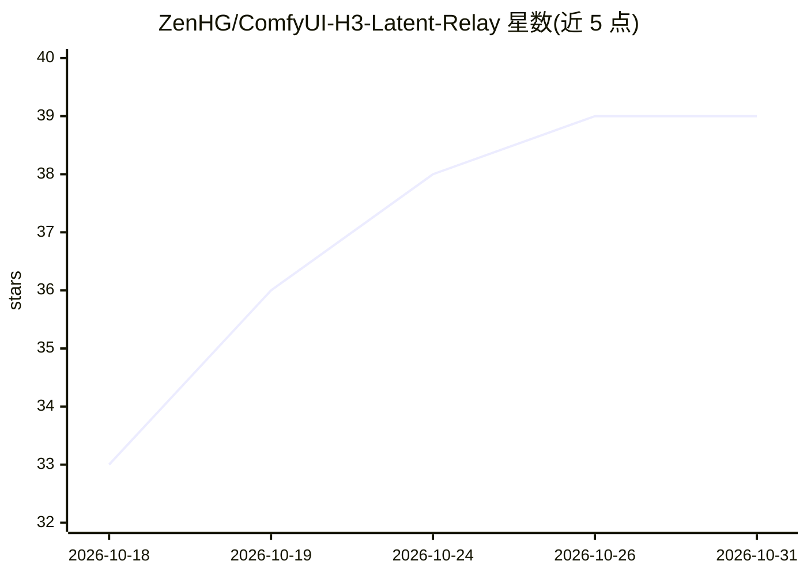

# ZenHG/ComfyUI-H3-Latent-Relay

⭐ 39 · Python · MIT · 推送 2026-10-26 · [GitHub](https://github.com/ZenHG/ComfyUI-H3-Latent-Relay) · [官网](https://registry.comfy.org/nodes/h3-latent-relay) · 个人维护 · 中文 README

**MiniMax-H3 多段视频续接的 ComfyUI 节点包：latent 桥零重编码**

面向 ComfyUI 用户的 MiniMax-H3 多段视频生成续接节点包：从上一段 AV latent 切尾段写入本段 minimax_keyframes，避免像素续接的 VAE 重编码往返。提供 11 个节点，覆盖 latent 存读、复合桥、音画同裁、后处理、音频缝、自动连跑（Chain/Finite Run）、latent 放大与从已有视频起段；支持声锚（voice_anchor）锁定跨段说话人音色。零第三方节点包依赖，仅依赖 ComfyUI 自带 torch 与 safetensors；要求宿主 ComfyUI ≥0.35.0 且带 MiniMax-H3 支持。放大节点需另装可选上游包与权重。

## 筛选速览

| 维度 | 判定 | 备注 |
|---|---|---|
| AI 角色 | `ai-ecosystem` | LLM/agent 周边工具 |
| 许可风险 | `permissive` | MIT |
| 部署形态 | `None` |  |
| 模型依赖 | — | README 未给出锁定关系 |
| 硬件要求 | — | 无带数字的原话,不猜 |
| 安装摩擦 | `medium` | 含编译或系统依赖之一 |
| 成熟度 | — | 结构信号不足 |

## 能力要点

- latent 桥续接：上一段尾 AV latent 逐位钉进本段，零重编码、无磁盘解码帧缓存
- 11 个节点分五层，最小工作流只需 3 个必备节点
- Chain/Finite Run 自动连跑多段，Finite Run 可无头一次提交跑完 N 段
- voice_anchor 声锚锁定跨段说话人音色，含 fail-closed 报错与多道降级路径

## 适用场景

- 在 ComfyUI 里生成 MiniMax-H3 长视频并保持段间画面与音频连贯
- 从一段已有视频起段，向外续接多段新内容
- 跨段换说话人时用声锚锁定音色，避免音色交叉污染
- 多段自动连跑并无损拼接成一条成片

## 场景标签

`视频生成` · 领域:内容生成

## 证据(README 行号)

> L5: MiniMax-H3 多段续接的 **latent 桥**（零重编码）—— 一个可独立使用、**零第三方节点包依赖**的 ComfyUI 节点包。
> L58: |**带 MiniMax-H3 支持的 ComfyUI ≥ 0.35.0**|✅|需要 `comfy_extras/nodes_minimax_h3.py` 与消费 `minimax_keyframes` / `minimax_r

## 星数曲线

2026-10-18 33 → 2026-10-31 39（+6）

---
*卡片 v1 · prompt 1.4 · 生成 2026-10-25 · 置信度 high · 依据 README sha `c9e794c7f31e` · [字段定义](../../DATASET.md)*
