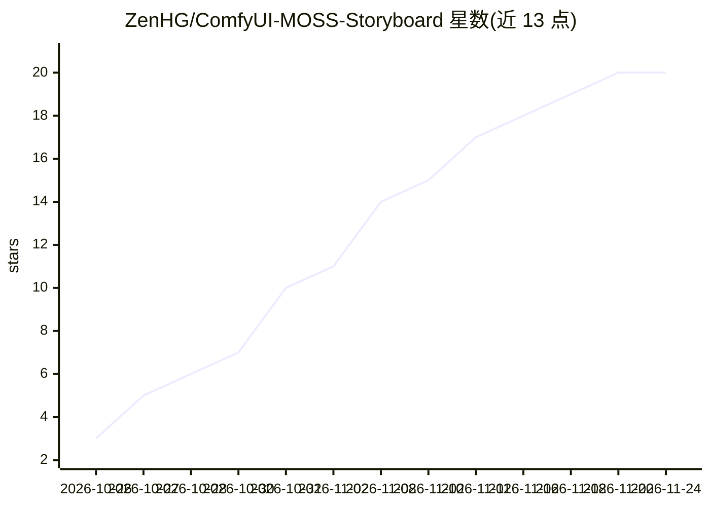

# ZenHG/ComfyUI-MOSS-Storyboard

⭐ 20 · Python · MIT · 推送 2026-11-13 · [GitHub](https://github.com/ZenHG/ComfyUI-MOSS-Storyboard) · [官网](https://registry.comfy.org/nodes/moss-storyboard) · 个人维护 · 中文 README

**ComfyUI 节点包：MOSS 图像故事板、局部编辑与 LLM 提示词**

面向 ComfyUI 的自定义节点集：将画布切分为 3/4/6/8/9 宫格并逐格裁切，支持单格修复后贴回、参考脸换脸；附带 LLM 提示词节点，可对最多 9 张参考图做 caption/expand/edit/assemble，输出 MiniMax-H3 格式，也可对接 Flux、SDXL、Qwen-Image。LLM 可走本地 GGUF（llama-server）或 OpenAI 兼容 API。核心节点零额外 pip 依赖，换脸自动蒙版需 insightface/onnxruntime。限定：布局框仅为提示不作坐标保证，跨格人物一致性不保证。

## 筛选速览

| 维度 | 判定 | 备注 |
|---|---|---|
| AI 角色 | `ai-ecosystem` | LLM/agent 周边工具 |
| 许可风险 | `permissive` | MIT |
| 部署形态 | `None` |  |
| 模型依赖 | local-ok | 支持本地模型 |
| 硬件要求 | — | 无带数字的原话,不猜 |
| 安装摩擦 | `low` | 无编译、无系统依赖或容器化 |
| 成熟度 | — | 结构信号不足 |

## 能力要点

- 3/4/6/8/9 宫格故事板生成与逐格精确裁切
- LLM 提示词节点支持 caption/expand/edit/assemble，最多 9 张参考图
- 换脸节点（insightface + onnxruntime 自动蒙版，默认开启）
- LLM 后端可选本地 GGUF 或 OpenAI 兼容 API（Ollama/LM Studio 等），API key 不随工作流保存

## 适用场景

- 在 ComfyUI 里用 MOSS-Image 生成多格漫画/故事板
- 修复或替换故事板中的单格画面而不影响其他格
- 用 LLM 把多张参考图编译成 H3 格式提示词

## 场景标签

`图像生成` `提示工程` · 领域:Agent 开发

## 证据(README 行号)

> L7: **Storyboard, local edit and LLM prompt nodes for ComfyUI.** Three uses:
> L22: |Host|**ComfyUI ≥ 0.42.0** (native MOSS-Image support)|

## 星数曲线

2026-10-26 3 → 2026-11-24 20（+17）

---
*卡片 v1 · prompt 1.4 · 生成 2026-11-18 · 置信度 high · 依据 README sha `75dab9afa094` · [字段定义](../../DATASET.md)*
