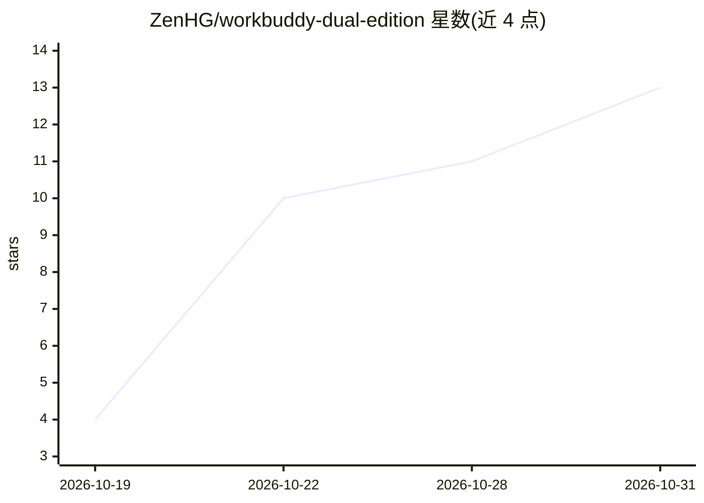

# ZenHG/workbuddy-dual-edition

⭐ 13 · MIT · 推送 2026-10-17 · [GitHub](https://github.com/ZenHG/workbuddy-dual-edition) · 个人维护 · 中文 README

**WorkBuddy 国内版/国际版同机共存的修复手册与 Agent Skill**

面向 Tencent WorkBuddy 桌面客户端用户的问题处置方案：针对『装国内版变国际版』『双开失败』『重启后自动更新互相覆盖』等故障，给出根因定位（两版本为独立产品，互斥锁与数据目录不同，破坏共存的是自动更新覆盖安装目录）与四步处置（关启动期强装、阻断更新下载落盘、分目录安装）。同时是一个可加载的 Agent Skill（SKILL.md），Windows 5.8.x 实测通过，macOS/Linux 路径未实测。采用方案需放弃自动更新，升级改为手动。

## 筛选速览

| 维度 | 判定 | 备注 |
|---|---|---|
| AI 角色 | `ai-knowledge` | 知识聚合/清单类 |
| 许可风险 | `permissive` | MIT |
| 部署形态 | `None` |  |
| 模型依赖 | — | README 未给出锁定关系 |
| 硬件要求 | — | 无带数字的原话,不猜 |
| 安装摩擦 | `low` | 无编译、无系统依赖或容器化 |
| 成熟度 | — | 结构信号不足 |

## 能力要点

- 提供根因分析与四步处置 playbook（references/full-playbook.md）
- SKILL.md 可放入 Agent skills 目录直接加载
- Windows + WorkBuddy 5.8.x 双版并存与重启不复发实测通过
- 如实标注 macOS/Linux 全链路未实测，路径需按本地日志核对

## 适用场景

- 解决装国内版却启动成国际版的问题
- 实现国内版与国际版客户端同机双开共存
- 阻止自动更新覆盖另一版本、重启后故障复发
- 让 AI Agent 按步骤代为诊断和修复

## 场景标签

`教程课程` · 领域:学习与行业

## 证据(README 行号)

> L25: **给 AI Agent 用**：把 `SKILL.md` 放进你的 skills 目录，它会自动带上前三个 references。
> L3: Tencent **WorkBuddy 国内版与国际版同机共存**的完整处置方案，同时是一个可直接加载的 Agent Skill。

## 星数曲线

2026-10-19 4 → 2026-10-31 13（+9）

---
*卡片 v1 · prompt 1.4 · 生成 2026-10-31 · 置信度 mid · 依据 README sha `28fc5cdd6f66` · [字段定义](../../DATASET.md)*
