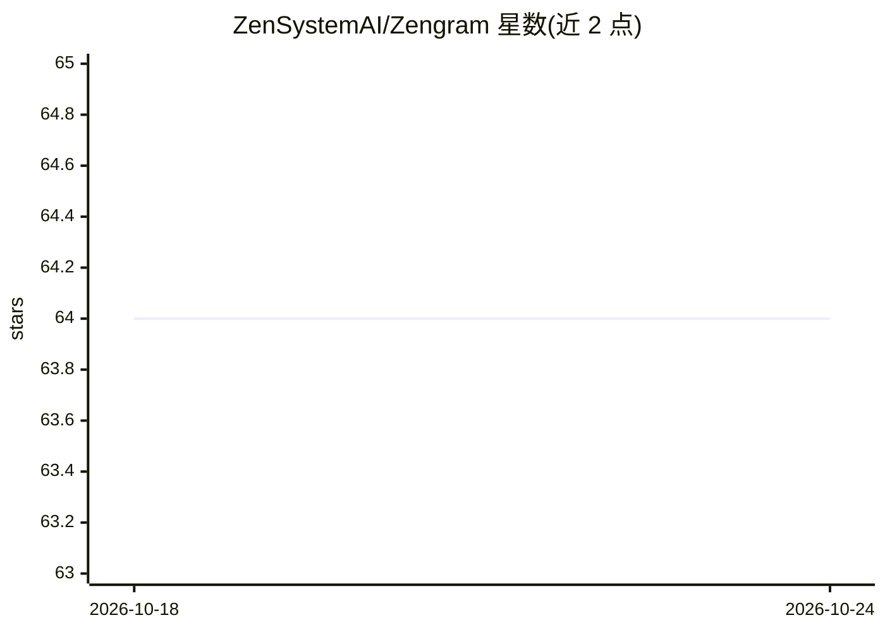

# ZenSystemAI/Zengram

⭐ 64 · JavaScript · MIT · 推送 2026-10-22 · [GitHub](https://github.com/ZenSystemAI/Zengram) · [官网](https://zensystem.ai) · 组织维护

**面向多 AI agent 的跨机器共享记忆系统（MCP 记忆服务）**

Zengram 为多个 AI agent 提供跨机器、跨会话的共享记忆后端：以单一 Postgres（pgvector HNSW）存储事件/事实/状态/决策四类记忆，检索走向量、全文、实体图三路并行并用 RRF 融合，可选 cross-encoder 重排，自述 LongMemEval 检索准确率 98.4%。面向运行 Claude Code、Cursor 等工具与自主 agent 的开发者，提供 MCP server（13 个工具）、Bash CLI 与 REST API，内置凭据脱敏、跨 agent 简报与 LLM 后台合并。MIT 许可，自托管。

## 筛选速览

| 维度 | 判定 | 备注 |
|---|---|---|
| AI 角色 | `ai-ecosystem` | LLM/agent 周边工具 |
| 许可风险 | `permissive` | MIT |
| 部署形态 | `library` | 以包/库形式分发 |
| 模型依赖 | — | README 未给出锁定关系 |
| 硬件要求 | — | 无带数字的原话,不猜 |
| 安装摩擦 | `low` | 无编译、无系统依赖或容器化 |
| 成熟度 | — | 结构信号不足 |

## 能力要点

- 四类有类型记忆（event/fact/status/decision），各有生命周期与衰减规则
- pgvector 向量 + Postgres 全文 + 实体图三路检索，RRF 融合与可选重排
- 跨 agent 简报、独立观察记录（observed_by）与凭据自动脱敏
- MCP server 提供 13 个 brain_* 工具，另有 Bash CLI 与 REST API

## 适用场景

- 让 Claude Code 与服务器上的自主 agent 共享同一份长期记忆
- 会话恢复时获取'我上次离开后发生了什么'的跨 agent 简报
- 为多个 agent 系统提供可自托管的统一记忆与语义检索后端

## 场景标签

`Agent 记忆` `多智能体` · 领域:Agent 开发

## 证据(README 行号)

> L21:  Zengram — shared memory for multi-agent AI systems
> L107: ### MCP Server (Claude Code, Cursor, Windsurf)

## 星数曲线

2026-10-18 64 → 2026-10-24 64（+0）

---
*卡片 v1 · prompt 1.4 · 生成 2026-10-24 · 置信度 high · 依据 README sha `dd7348e16eb6` · [字段定义](../../DATASET.md)*
