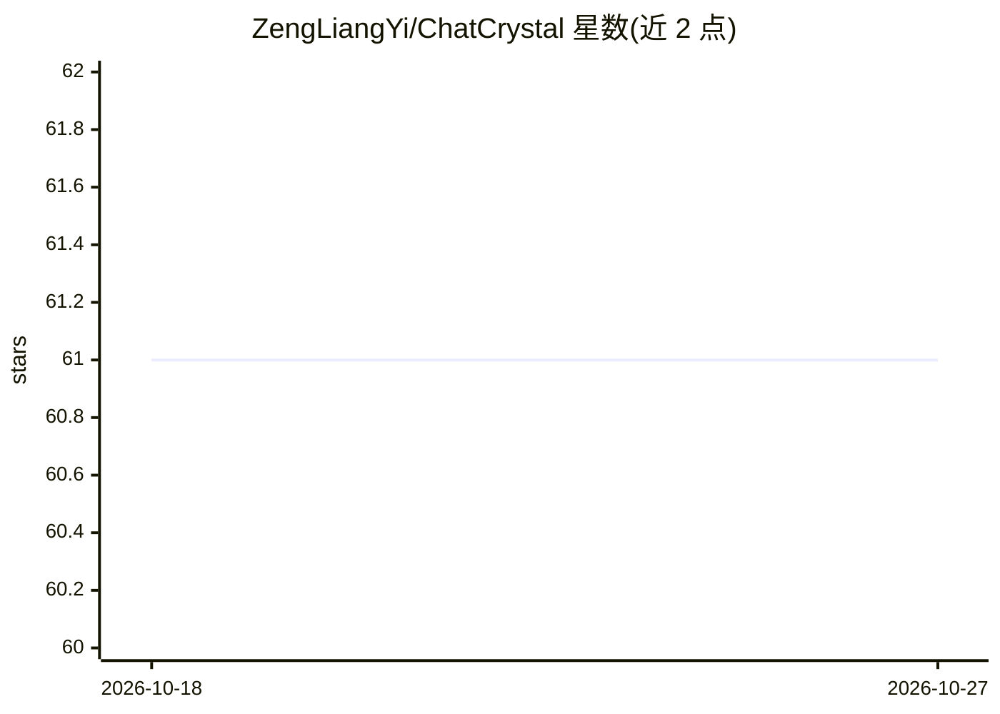

# ZengLiangYi/ChatCrystal

⭐ 61 · TypeScript · Apache-2.0 · 推送 2026-10-26 · [GitHub](https://github.com/ZengLiangYi/ChatCrystal) · [官网](https://zengliangyi.github.io/ChatCrystal/) · 个人维护 · 中文 README

**面向开发者的本地优先 AI 编程对话知识管理应用**

Electron 桌面应用（含 CLI/Web 与 Docker 自托管模式），面向使用 Claude Code、Cursor、Codex CLI、Trae、GitHub Copilot 的开发者：从本地工具数据目录导入 AI 编程对话，借助可配置的 LLM 与 embedding 提供方将对话提炼为含标题、摘要、结论、片段与标签的结构化笔记，支持语义搜索、标签共现知识图谱、Markdown 导出，并通过 MCP server 让 agent 读取与写回经验。要求 Node.js >= 24，需自行配置 LLM 与 embedding 提供方（两者分开配置）。

## 筛选速览

| 维度 | 判定 | 备注 |
|---|---|---|
| AI 角色 | `ai-native` | 本体是模型或模型工具 |
| 许可风险 | `permissive` | Apache-2.0 |
| 部署形态 | `self-host` | docker 或自建部署 |
| 模型依赖 | local-ok | 支持本地模型 |
| 硬件要求 | — | 无带数字的原话,不猜 |
| 安装摩擦 | `low` | 无编译、无系统依赖或容器化 |
| 成熟度 | — | 结构信号不足 |

## 能力要点

- 从 Claude Code/Cursor/Codex/Trae/Copilot 本地目录导入对话
- LLM 提炼结构化笔记（标题/摘要/结论/片段/标签）
- embedding 语义搜索与标签共现知识图谱
- CLI 与 MCP 工具供 agent 读取和写回经验

## 适用场景

- 把散落的 AI 编程对话整理成可检索的知识库
- 让 coding agent 通过 MCP 复用以往经验记忆
- 多设备自托管同步 AI 对话知识库

## 场景标签

`知识库管理` `知识图谱` `语义搜索` · 领域:知识与检索

## 证据(README 行号)

> L24: ChatCrystal is a local-first AI PKM app for developers who solve real problems with Claude Code, Cursor, Codex CLI,
> L26: It turns scattered AI coding conversations into structured notes, semantic search, a tag knowledge graph, Markdown 
> L55: - **Runs locally** with configurable LLM and embedding providers.

## 星数曲线

2026-10-18 61 → 2026-10-27 61（+0）

---
*卡片 v1 · prompt 1.4 · 生成 2026-10-24 · 置信度 high · 依据 README sha `bc7bb1edc171` · [字段定义](../../DATASET.md)*
