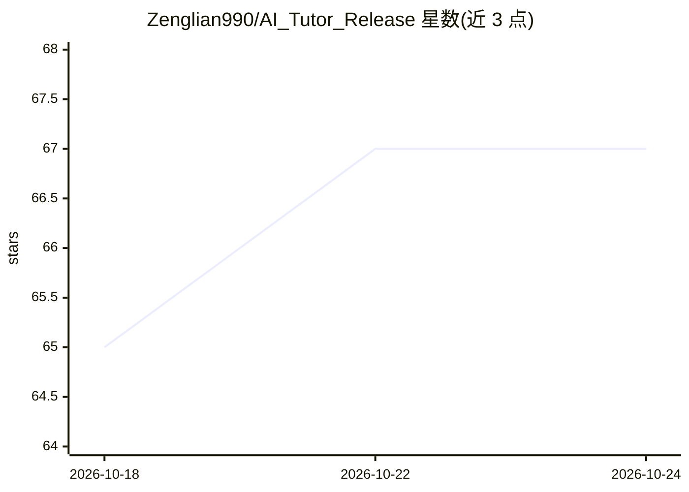

# Zenglian990/AI_Tutor_Release

⭐ 67 · JavaScript · MIT · 推送 2026-10-21 · [GitHub](https://github.com/Zenglian990/AI_Tutor_Release) · 个人维护 · 中文 README

**面向1-9年级学生的开源 RAG AI 教辅私教（移动/Web 应用）**

覆盖人教版1-9年级全学科的开源 AI 教辅应用：基于 LanceDB 教材向量知识库做 RAG 检索，接入 DeepSeek V3 与 Gemini 2.5 双模型通道，提供拍照搜题与分题、语音交互、按年级自适应心智模型的苏格拉底式引导、39,114+ 母题题库、错题本与 A4 试卷打印、家长学情看板等功能。面向学生与家长使用，提供 Android APK、iOS PWA/IPA、云端 Web 与本地 Node.js 启动脚本四种使用途径；本地运行需申请 Gemini API Key，全量教材入库需 Python 环境处理 PDF。

## 筛选速览

| 维度 | 判定 | 备注 |
|---|---|---|
| AI 角色 | `ai-native` | 本体是模型或模型工具 |
| 许可风险 | `permissive` | MIT |
| 部署形态 | `library` | 以包/库形式分发 |
| 模型依赖 | locked-api |  |
| 硬件要求 | — | 无带数字的原话,不猜 |
| 安装摩擦 | `low` | 无编译、无系统依赖或容器化 |
| 成熟度 | — | 结构信号不足 |

## 能力要点

- LanceDB 教材向量知识库 RAG 检索，支持 Demo 数据与全量 PDF 入库两种方式
- DeepSeek V3 与 Gemini 2.5 Flash 双模型通道，用户可一键切换
- 拍照搜题含整页自动分题、五步视觉转录锚定与切片无损直通
- 1-9 年级心智模型自动适配与苏格拉底启发式引导，错题变式闭环

## 适用场景

- 家长为孩子寻找覆盖人教版全学科的课后 AI 辅导工具
- 拍照拍题后获得分步引导而非直接答案
- 错题归档、生成变式练习卷并打印 A4 试卷
- 家长查看每周学情报告与薄弱点追踪

## 场景标签

`文档问答` · 领域:知识与检索

## 证据(README 行号)

> L88: 「曾练专属私教」摒弃了市面上传统搜题软件“直接给答案抄袭”的应试弊端，基于大语言模型与 LanceDB 精准教材向量知识库构建了真正的**“学-练-测-辅-管”全闭环 AI 私教智能体**：
> L100:  - **DeepSeek-V3 极速版**：国内高速直连，首字响应（TTFT）低至 **0.4 秒**，问答干脆利落，体验行云流水。

## 星数曲线

2026-10-18 65 → 2026-10-24 67（+2）

---
*卡片 v1 · prompt 1.4 · 生成 2026-10-24 · 置信度 mid · 依据 README sha `1de41d61d46b` · [字段定义](../../DATASET.md)*
