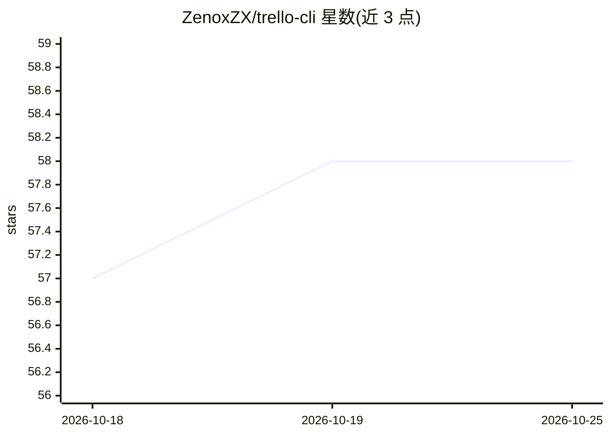

# ZenoxZX/trello-cli

⭐ 58 · C# · MIT · 推送 2026-05-05 · [GitHub](https://github.com/ZenoxZX/trello-cli) · 个人维护

**通过 Claude Code 用自然语言管理 Trello 看板的 CLI 工具**

命令行工具，封装 Trello API，供 Claude Code 调用：列出看板、查看/创建/更新卡片、在列表间移动卡片、追踪任务。用户在与 Claude Code 对话中提及 Trello 即可触发；通过 SKILL.md 技能文件定义触发规则与命令参考，可复制到 ~/.claude/skills 实现全局激活。需要 Trello API 密钥与令牌认证，要求 .NET 10.0 或更高版本，经 install.sh 或手动 dotnet 构建安装。

## 筛选速览

| 维度 | 判定 | 备注 |
|---|---|---|
| AI 角色 | `ai-ecosystem` | LLM/agent 周边工具 |
| 许可风险 | `permissive` | MIT |
| 部署形态 | `None` |  |
| 模型依赖 | locked-api |  |
| 硬件要求 | — | 无带数字的原话,不猜 |
| 安装摩擦 | `medium` | 含编译或系统依赖之一 |
| 成熟度 | — | 结构信号不足 |

## 能力要点

- 封装 Trello API：看板/列表/卡片的查询与操作
- 以 Claude Code skill 文件（SKILL.md/REFERENCE.md）定义触发与命令参考
- 技能可复制到个人 ~/.claude/skills 目录全局激活
- 提供 install.sh 一键安装并自动安装 Claude Code 技能

## 适用场景

- 在 Claude Code 对话中用自然语言管理 Trello 任务
- 把 Trello 卡片操作接入 AI 编码工作流
- 追踪并移动任务卡片而无需打开 Trello 界面

## 场景标签

`工作流自动化` · 领域:效率与自动化

## 证据(README 行号)

> L3: A CLI tool that provides Trello integration with Claude Code. With this tool, you can manage your Trello boards, lis
> L7: `trello-cli` is a command-line tool that communicates with the Trello API. Claude Code uses this tool to:
> L89: This repo uses Claude Code's **skill** system. Skills are configuration files that give Claude Code specialized cap

## 星数曲线

2026-10-18 57 → 2026-10-25 58（+1）

---
*卡片 v1 · prompt 1.4 · 生成 2026-10-24 · 置信度 high · 依据 README sha `775453b867d3` · [字段定义](../../DATASET.md)*
