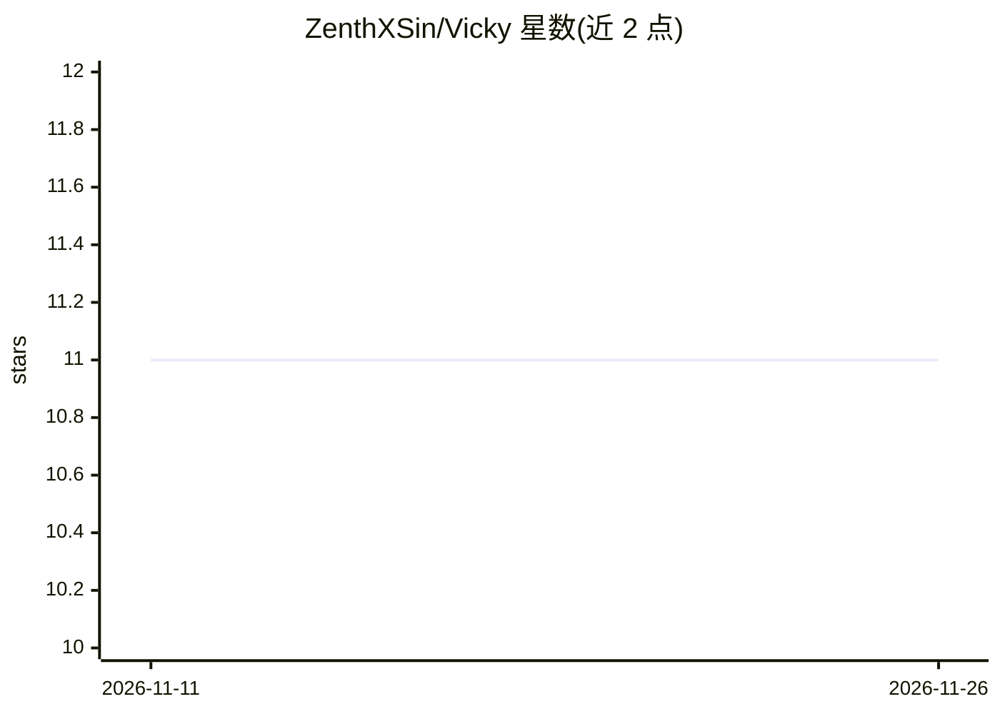

# ZenthXSin/Vicky

⭐ 11 · Kotlin · MIT · 推送 2026-09-12 · [GitHub](https://github.com/ZenthXSin/Vicky) · 个人维护 · 中文 README

**给 Kotlin/JVM 开发者的精简 Agent 框架**

用 Kotlin 编写的 Agent 框架，对接 OpenAI 通用协议（兼容 OpenAI/DeepSeek/one-api/本地推理服务），底层复用 aallam/openai-kotlin 客户端，agent 主循环、模式、权限、工具注册自实现。提供多模式推理、按 userId+toolName 的权限系统、运行时工具增删、上下文压缩、Qdrant 语义记忆与记忆蒸馏、文件语义索引、SKILL.md 技能系统和 TypeScript 脚本引擎；通过 KSP 注解生成工具代码，支持作为 Maven 依赖嵌入 JVM/Android 项目，附 Vibe 单轮编排内核与交互式 CLI 示例。

## 筛选速览

| 维度 | 判定 | 备注 |
|---|---|---|
| AI 角色 | `ai-ecosystem` | LLM/agent 周边工具 |
| 许可风险 | `permissive` | MIT |
| 部署形态 | `None` |  |
| 模型依赖 | — | README 未给出锁定关系 |
| 硬件要求 | — | 无带数字的原话,不猜 |
| 安装摩擦 | `medium` | 含编译或系统依赖之一 |
| 成熟度 | — | 结构信号不足 |

## 能力要点

- 对接 OpenAI 通用协议，兼容 DeepSeek/one-api/本地推理服务
- KSP 注解 @VickyTool 编译期生成工具代码
- Qdrant 语义记忆：原始对话+蒸馏记忆双层存储与每日蒸馏
- SKILL.md 技能分组与 TS 脚本引擎（Rhino+内嵌 TS 编译器）

## 适用场景

- 在 Kotlin/Android 应用中嵌入带工具调用的对话 Agent
- 为 Agent 配置长期记忆与文件语义检索
- 用脚本动态扩展 Agent 工具而不重编译主程序

## 场景标签

`Agent 框架` `Agent 记忆` · 领域:Agent 开发

## 证据(README 行号)

> L13: 一个精简、易维护的 Kotlin Agent 框架，对接 **OpenAI 通用协议**（兼容 OpenAI / DeepSeek / one-api / 本地推理服务等）。
> L15: 底层用 aallam/openai-kotlin 作 API 客户端，agent 主循环、模式、权限、工具注册全部自写，方便按需改造。
> L62: ├── vicky-core/          # 核心框架（Maven: io.github.zenthxsin:vicky-core）

## 星数曲线

2026-11-11 11 → 2026-11-26 11（+0）

---
*卡片 v1 · prompt 1.4 · 生成 2026-11-18 · 置信度 high · 依据 README sha `ba0af05469b9` · [字段定义](../../DATASET.md)*
