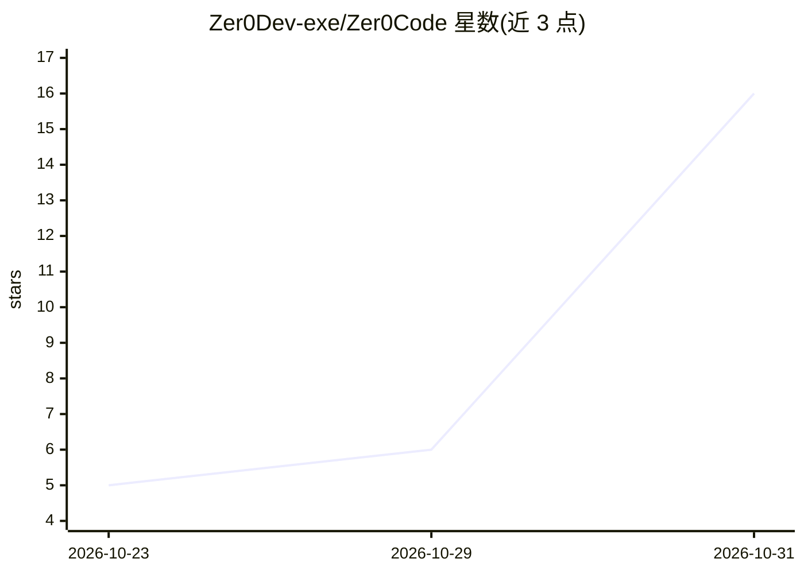

# Zer0Dev-exe/Zer0Code

⭐ 16 · JavaScript · MIT · 推送 2026-10-30 · [GitHub](https://github.com/Zer0Dev-exe/Zer0Code) · 个人维护

**编排 Claude Code/Codex/Gemini CLI 的多端代码代理指挥台**

跨桌面、Web 与移动端的 AI 编码代理编排器：将 Claude Code、Codex 与 Gemini CLI 聚合到同一界面，核心机制为一个模型开发代码、另一家族模型（如 ChatGPT/Codex）同步或结束时审查 git diff 并留评。任务在自有 PC 或 VPS 上的服务端执行，关闭客户端后仍继续运行并推送通知；命令与文件编辑需用户逐条批准。提供 Windows/macOS/Linux 桌面安装包、服务器安装包与 Android APK，也可 PWA 安装到手机；支持多用户与各自消费限额，密钥与对话数据留在本机。安装包未付费签名，Android 应用无推送通知。

## 筛选速览

| 维度 | 判定 | 备注 |
|---|---|---|
| AI 角色 | `ai-ecosystem` | LLM/agent 周边工具 |
| 许可风险 | `permissive` | MIT |
| 部署形态 | `desktop` | 安装包/桌面程序 |
| 模型依赖 | locked-api |  |
| 硬件要求 | — | 无带数字的原话,不猜 |
| 安装摩擦 | `low` | 无编译、无系统依赖或容器化 |
| 成熟度 | — | 结构信号不足 |

## 能力要点

- 一模型开发、另一模型实时与最终审查（基于 git diff，含批准流）
- 桌面/Web/移动端同步同一会话，服务端持续执行任务并通知
- Windows/macOS/Linux 安装包、Android APK、PWA 与源码多种运行方式
- 多用户各自目录与消费限额，密钥与数据留存本机/VPS

## 适用场景

- 在我的电脑或 VPS 上统一管理 Claude Code、Codex、Gemini CLI 编码代理
- 在手机上发起编码任务，稍后收到完成通知并继续会话
- 用一个模型开发、另一个模型交叉审查代码改动

## 场景标签

`编码 Agent` `代码审查` `多智能体` · 领域:Agent 开发

## 证据(README 行号)

> L6:  Un orquestador de agentes: un modelo escribe el código y otro, de otra familia, lo revisa a la vez.
> L23: Zer0Code es un orquestador de agentes con app de escritorio, web y móvil. Combina Claude Code, Codex y Gemini CLI e
> L154: ## 🧑‍💻 Orquestador de agentes

## 星数曲线

2026-10-23 5 → 2026-10-31 16（+11）

---
*卡片 v1 · prompt 1.4 · 生成 2026-10-30 · 置信度 high · 依据 README sha `e7885f885a44` · [字段定义](../../DATASET.md)*
