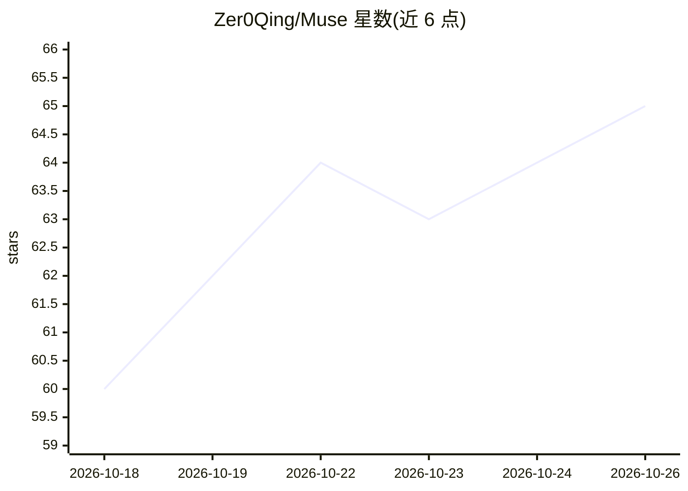

# Zer0Qing/Muse

⭐ 65 · Kotlin · GPL-3.0 · 推送 2026-10-24 · [GitHub](https://github.com/Zer0Qing/Muse) · [官网](https://museai.ltd) · 个人维护 · 中文 README

**本地优先的开源 Android AI 伴侣应用，带持久记忆与系统能力**

用 Kotlin/Jetpack Compose 编写的 Android AI 伴侣应用：通过对话→事实提取→滚动摘要→深度处理的四层记忆流水线跨会话记住用户；经无障碍/Shizuku/Root/Termux 四通道注册 141 个工具，在设备上执行读屏、点击、截屏、终端、虚拟屏与视觉驱动 GUI Agent 等操作；支持 40+ 预置模型供应商、多助手群聊会议、RAG 知识库、微信/QQ 等五端渠道接入；数据默认全部本地存储，PII 发送前自动打码。APK 直接安装，从源码构建需 JDK 21 与 Android SDK。朋友圈/日记本等功能自述为早期实验版本。

## 筛选速览

| 维度 | 判定 | 备注 |
|---|---|---|
| AI 角色 | `ai-native` | 本体是模型或模型工具 |
| 许可风险 | `viral` | GPL-3.0 |
| 部署形态 | `None` |  |
| 模型依赖 | — | README 未给出锁定关系 |
| 硬件要求 | — | 无带数字的原话,不猜 |
| 安装摩擦 | `high` | 编译与系统依赖俱全 |
| 成熟度 | `idea` | |

## 能力要点

- 四层记忆流水线：事实提取、滚动摘要、编译聚合、深度处理，关键事实受保护不衰减
- 无障碍/Shizuku/Root/Termux 四通道，141 个注册工具，含终端、虚拟屏与视觉驱动 GUI Agent
- 40+ 预置模型供应商，原生支持 OpenAI/Anthropic/Gemini 协议与 OpenAI 兼容端点
- 微信/QQ/飞书/Telegram/钉钉五端渠道接入，每个联系人独立会话上下文

## 适用场景

- 在手机上和一个跨会话记住自己的 AI 伴侣持续对话
- 让 AI 通过无障碍或 Root 通道在手机里代为执行操作
- 把 AI 助手接入微信、QQ、飞书等日常聊天工具
- 本地优先、无账号无遥测地使用多模型 AI 助手

## 场景标签

`AI 助手` `聊天机器人` `GUI 自动化` `Agent 记忆` · 领域:Agent 开发

## 证据(README 行号)

> L26: 每次打开新的 AI 对话，都要从头自我介绍一遍？Muse 不用。
> L28: Muse 是一个运行在 Android 上的开源 AI 伴侣：**通过四层记忆系统真正记住你**，通过无障碍 / Shizuku / Root 三层权限通道**在你手机里真正动手**，还有自己的内心（Mood）与生活——朋友圈、日

## 星数曲线

2026-10-18 60 → 2026-10-26 65（+5）

---
*卡片 v1 · prompt 1.4 · 生成 2026-10-24 · 置信度 high · 依据 README sha `a9c2099edc98` · [字段定义](../../DATASET.md)*
