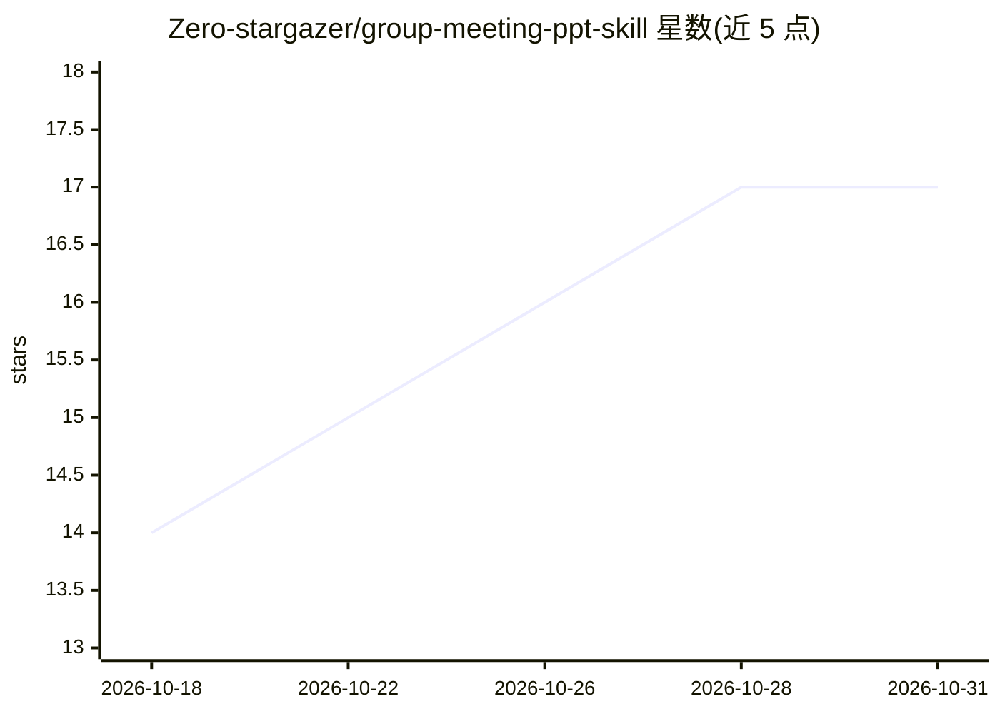

# Zero-stargazer/group-meeting-ppt-skill

⭐ 17 · Python · MIT · 推送 2026-07-15 · [GitHub](https://github.com/Zero-stargazer/group-meeting-ppt-skill) · 个人维护 · 中文 README

**输入论文 PDF 生成可编辑中文组会汇报 PPTX 的 Codex Skill**

面向中文组会、文献汇报与 journal club 场景的 Codex Skill：读取论文全文与主图，按证据链组织研究问题、方法、结论与讨论问题，生成已填充的可编辑 PPTX 及简短事实核对清单；页数由论文图表链与汇报时长决定，不固定为统一页数。图表采用面板级实图裁切并保留图号与来源；每份成品交付前经过规格校验、全页渲染检查与溢出检测。可与 paper-triage-skill 通过交接文件衔接。声明不伪造数据、引用或结论。

## 筛选速览

| 维度 | 判定 | 备注 |
|---|---|---|
| AI 角色 | `ai-native` | 本体是模型或模型工具 |
| 许可风险 | `permissive` | MIT |
| 部署形态 | `None` |  |
| 模型依赖 | — | README 未给出锁定关系 |
| 硬件要求 | — | 无带数字的原话,不猜 |
| 安装摩擦 | `low` | 无编译、无系统依赖或容器化 |
| 成熟度 | — | 结构信号不足 |

## 能力要点

- 从论文 PDF 与汇报时长生成已填充、可编辑的 PPTX
- 页数由图表链与时长决定，支持主图拆页与证据合并
- 交付前通过规格校验、全页渲染检查与溢出检测
- 提供事实核对清单，声明不伪造数据、引用或结论

## 适用场景

- 研一、硕博学生把论文 PDF 快速转为组会汇报 PPT 草稿
- journal club / 文献汇报前的图表组织与讲解要点准备
- 配合 paper-triage-skill 从论文筛选到汇报的流程衔接

## 场景标签

`科研工具` · 领域:学习与行业

## 证据(README 行号)

> L3: > 输入论文 PDF 与汇报时长，自动生成一份可直接用于组会汇报、可编辑的中文 PPTX。
> L5: `group-meeting-ppt-skill` 是一个面向中文组会、文献汇报和 journal club 的 Codex Skill。它会读取论文全文与主图，组织研究问题、方法、证据链、结论和讨论问题，并生成一份已填充的可编辑 

## 星数曲线

2026-10-18 14 → 2026-10-31 17（+3）

---
*卡片 v1 · prompt 1.4 · 生成 2026-10-29 · 置信度 high · 依据 README sha `a7d5b9844128` · [字段定义](../../DATASET.md)*
