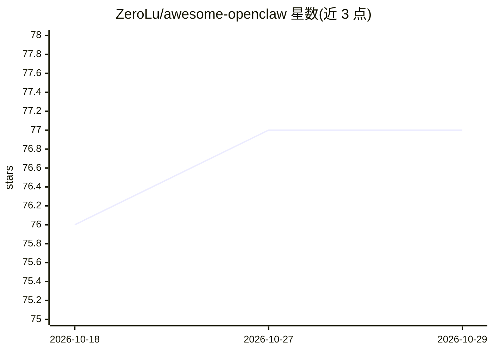

# ZeroLu/awesome-openclaw

⭐ 77 · 推送 2026-03-10 · [GitHub](https://github.com/ZeroLu/awesome-openclaw) · 个人维护 · 中文 README

**OpenClaw 教程、技能与用例的策展清单**

面向个人 AI 助手框架 OpenClaw 的 Awesome 清单：提供安装途径对比（官方脚本、EasyClaw、腾讯云/阿里云等托管方案）、5400+ 社区技能的分类精选（AI 编码、浏览器自动化、搜索研究、消息集成、图像视频生成等）、面向办公/内容创作/炒股/跨境电商/电商运营的预配置技能包，以及内容消费、自动化等真实用例汇编。内容以表格与一键安装提示词组织，双语（英文/简体中文）提供。

## 筛选速览

| 维度 | 判定 | 备注 |
|---|---|---|
| AI 角色 | `ai-knowledge` | 知识聚合/清单类 |
| 许可风险 | `none` | — |
| 部署形态 | `None` |  |
| 模型依赖 | — | README 未给出锁定关系 |
| 硬件要求 | — | 无带数字的原话,不猜 |
| 安装摩擦 | `low` | 无编译、无系统依赖或容器化 |
| 成熟度 | — | 结构信号不足 |

## 能力要点

- 覆盖安装、技能、技能包、用例四大部分的策展结构
- 收录 5400+ 社区技能并按类别精选条目
- 5 个面向具体人群的预配置技能包（含一键安装提示词）

## 适用场景

- 查找 OpenClaw 的安装方案与技能生态
- 为办公、内容创作、电商等场景挑选技能包
- 了解 OpenClaw 的真实使用案例

## 场景标签

`精选清单` · 领域:学习与行业

## 证据(README 行号)

> L5: > A curated collection of OpenClaw tutorials, skills, and use cases.
> L99: ## 2. Awesome Skills

## 星数曲线

2026-10-18 76 → 2026-10-29 77（+1）

---
*卡片 v1 · prompt 1.4 · 生成 2026-10-24 · 置信度 high · 依据 README sha `7b491db76957` · [字段定义](../../DATASET.md)*
