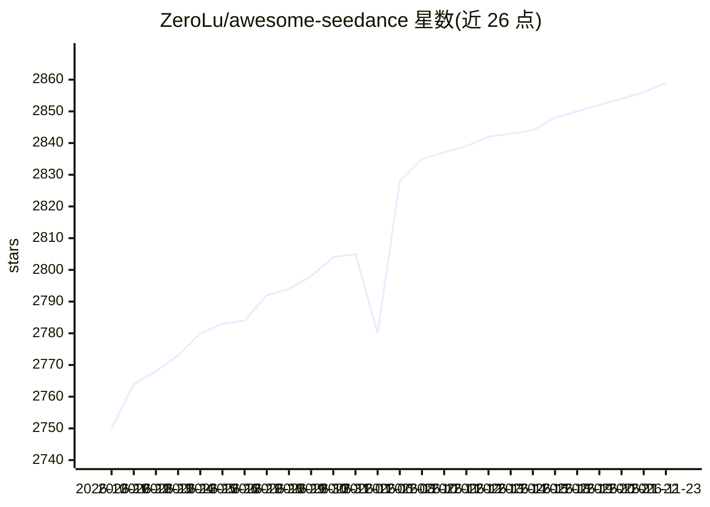

# ZeroLu/awesome-seedance

⭐ 2,859 · Shell · MIT · 推送 2026-11-22 · [GitHub](https://github.com/ZeroLu/awesome-seedance) · [官网](https://cyberbara.com/seedance2.0?utm_source=awesome-seedance) · 个人维护 · 中文 README

**为视频创作者整理 Seedance 2.0 提示词与资源的策展清单**

以 awesome 清单形式收集 Seedance 2.0 提示词与教程资源：按电影感影像、广告品牌、社交媒体梗图、UGC、动画、短剧、视效实验等类别组织，每条包含完整提示词文本、示例视频链接与来源署名（X/微信/Replicate 博客等），并收录 API 使用与工作流资源章节。README 提供 7 种语言版本，MIT 许可，标注更新日期，含赞助方栏目。本身不提供模型运行或生成能力，属资料聚合。

## 筛选速览

| 维度 | 判定 | 备注 |
|---|---|---|
| AI 角色 | `ai-knowledge` | 知识聚合/清单类 |
| 许可风险 | `permissive` | MIT |
| 部署形态 | `None` |  |
| 模型依赖 | — | README 未给出锁定关系 |
| 硬件要求 | — | 无带数字的原话,不猜 |
| 安装摩擦 | `low` | 无编译、无系统依赖或容器化 |
| 成熟度 | — | 结构信号不足 |

## 能力要点

- 按 7 个创作场景分类组织提示词条目
- 每条提示词附示例视频链接与来源署名
- 提供英/中/德/法/西/日多语言 README
- 含 API 使用与视频生成工作流资源章节

## 适用场景

- 查找电影感视频生成的提示词模板
- 为广告或社交媒体内容寻找视频生成写法参考
- 了解 Seedance 2.0 的 API 与工作流资源入口

## 场景标签

`精选清单` `视频生成` · 领域:内容生成

## 证据(README 行号)

> L9: > A curated collection of the **best Seedance 2.0 prompts**, video generation techniques, and resources for advanced
> L11: This repository focuses on **high-fidelity Seedance 2.0 prompts** sourced from X (Twitter), WeChat, and top prompt 
> L34: 8. Resources (API & How-to-use)

## 星数曲线

2026-10-21 2,750 → 2026-11-23 2,859（+109）

---
*卡片 v1 · prompt 1.4 · 生成 2026-11-23 · 置信度 high · 依据 README sha `c39790443fe3` · [字段定义](../../DATASET.md)*
