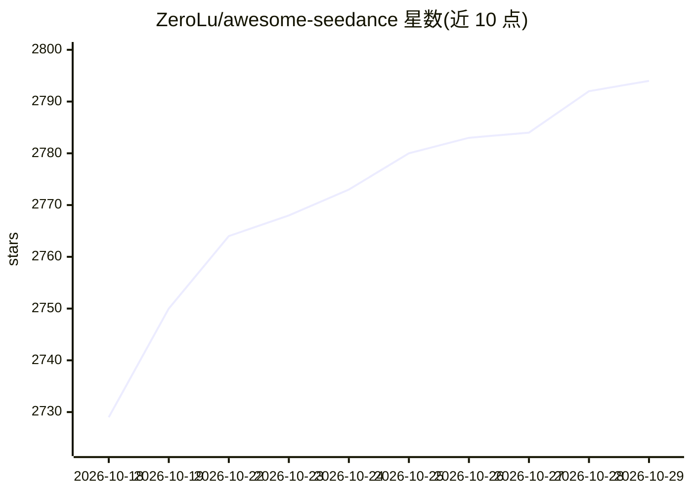

# ZeroLu/awesome-seedance

⭐ 2,794 · Shell · MIT · 推送 2026-10-28 · [GitHub](https://github.com/ZeroLu/awesome-seedance) · [官网](https://cyberbara.com/seedance2.0?utm_source=awesome-seedance) · 个人维护 · 中文 README

**Seedance 2.0 视频生成提示词与资源策展清单**

面向 Seedance 2.0 视频生成模型用户的提示词合集：从 X (Twitter)、微信与提示词工程师处收集高保真提示词，按电影风格、广告品牌、社媒 meme、UGC、动漫、短剧、视觉实验等类别组织，覆盖 15 秒时间码分段、镜头语言与导演风格模板等写法。条目附示例视频链接与来源署名，并收录 API 指南与使用方法资源。提供英/中/德/法/西/日多语言 README 版本。内容为文档型清单，不含可安装代码。

## 筛选速览

| 维度 | 判定 | 备注 |
|---|---|---|
| AI 角色 | `ai-knowledge` | 知识聚合/清单类 |
| 许可风险 | `permissive` | MIT |
| 部署形态 | `None` |  |
| 模型依赖 | — | README 未给出锁定关系 |
| 硬件要求 | — | 无带数字的原话,不猜 |
| 安装摩擦 | `low` | 无编译、无系统依赖或容器化 |
| 成熟度 | — | 结构信号不足 |

## 能力要点

- 按 8 个类别组织的 Seedance 2.0 提示词合集
- 包含时间码分段（0-4s/4-8s）与导演风格模板示例
- 条目附示例视频与来源署名（X/Replicate 博客等）
- 多语言 README（英/中/德/法/西/日）

## 适用场景

- 写 Seedance 视频提示词时参考电影级镜头与风格模板
- 了解 Seedance 2.0 在广告、UGC、动漫等场景的提示词写法
- 查找 Seedance API 与使用方法资源

## 场景标签

`提示工程` `视频生成` · 领域:Agent 开发

## 证据(README 行号)

> L9: > A curated collection of the **best Seedance 2.0 prompts**, video generation techniques, and resources for advanced
> L25: ## 📖 Table of Contents

## 星数曲线

2026-10-18 2,729 → 2026-10-29 2,794（+65）

---
*卡片 v1 · prompt 1.4 · 生成 2026-10-21 · 置信度 high · 依据 README sha `63109fd185c0` · [字段定义](../../DATASET.md)*
