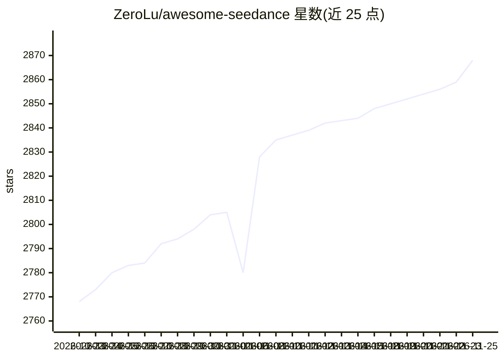

# ZeroLu/awesome-seedance

⭐ 2,868 · Shell · MIT · 推送 2026-11-24 · [GitHub](https://github.com/ZeroLu/awesome-seedance) · [官网](https://cyberbara.com/seedance2.0?utm_source=awesome-seedance) · 个人维护 · 中文 README

**Seedance 2.0 视频生成提示词与资源集合**

收录来自 X、微信公众号与提示词工程师的 Seedance 2.0 提示词，按电影风格、广告、社交媒体梗图、UGC、动漫、短剧、特效实验等类别组织，每个条目附提示词文本与示例视频链接；另设资源章节收录 API 与使用教程链接。README 提供英中德法西日多语言切换，以 MIT 许可发布，由赞助商 API 平台支持维护。

## 筛选速览

| 维度 | 判定 | 备注 |
|---|---|---|
| AI 角色 | `ai-knowledge` | 知识聚合/清单类 |
| 许可风险 | `permissive` | MIT |
| 部署形态 | `None` |  |
| 模型依赖 | — | README 未给出锁定关系 |
| 硬件要求 | — | 无带数字的原话,不猜 |
| 安装摩擦 | `low` | 无编译、无系统依赖或容器化 |
| 成熟度 | — | 结构信号不足 |

## 能力要点

- 按 7 类使用场景组织的 Seedance 2.0 提示词集合
- 每条提示词附带示例视频链接与来源署名
- 含 Replicate 博客收集的分镜时间轴（time-coded）提示词范例
- 提供 API 指南与使用教程的资源章节

## 适用场景

- 为 Seedance 2.0 生成电影感视频寻找可用提示词
- 参考分镜时间轴写法编排 15 秒视频场景
- 查找 Seedance API 与使用教程资源

## 场景标签

`视频生成` `精选清单` · 领域:内容生成

## 证据(README 行号)

> L9: > A curated collection of the **best Seedance 2.0 prompts**, video generation techniques, and resources for advanced
> L11: This repository focuses on **high-fidelity Seedance 2.0 prompts** sourced from X (Twitter), WeChat, and top prompt 
> L34: 8. Resources (API & How-to-use)

## 星数曲线

2026-10-23 2,768 → 2026-11-25 2,868（+100）

---
*卡片 v1 · prompt 1.4 · 生成 2026-11-24 · 置信度 high · 依据 README sha `160a9017ee45` · [字段定义](../../DATASET.md)*
