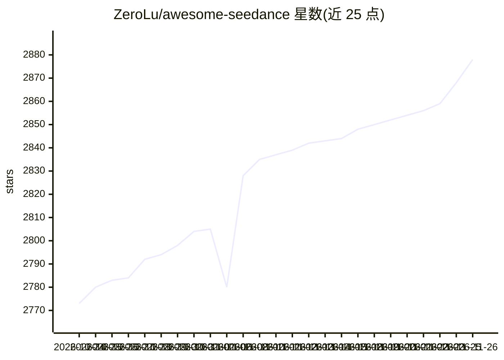

# ZeroLu/awesome-seedance

⭐ 2,878 · Shell · MIT · 推送 2026-11-25 · [GitHub](https://github.com/ZeroLu/awesome-seedance) · [官网](https://cyberbara.com/seedance2.0?utm_source=awesome-seedance) · 组织维护 · 中文 README

**Seedance 2.0 视频生成提示词与资源合集**

面向 Seedance 2.0 用户的提示词策展仓库：从 X（Twitter）、微信公众号与提示词工程师处收集视频生成提示词，按电影风格、广告品牌、社交媒体梗图、UGC、动画、短剧、特效实验等类别组织，每条附提示词文本、示例视频链接与来源出处；另含 API 使用与进阶工作流资源章节，支持中英德法西日多语言，以 MIT 许可发布，README 由赞助方支持维护。

## 筛选速览

| 维度 | 判定 | 备注 |
|---|---|---|
| AI 角色 | `ai-knowledge` | 知识聚合/清单类 |
| 许可风险 | `permissive` | MIT |
| 部署形态 | `None` |  |
| 模型依赖 | — | README 未给出锁定关系 |
| 硬件要求 | — | 无带数字的原话,不猜 |
| 安装摩擦 | `low` | 无编译、无系统依赖或容器化 |
| 成熟度 | — | 结构信号不足 |

## 能力要点

- 按 7 类风格组织的高保真视频提示词合集
- 每条提示词附示例视频链接与来源作者
- 含时间戳分镜式提示词写法示例（如 15 秒三段式）
- 提供 API 使用与 how-to-use 资源章节，多语言版本

## 适用场景

- 查找电影感、动画、广告类视频生成的提示词模板
- 参考时间戳分镜提示词组织长镜头视频生成
- 检索 Seedance API 相关教程资源

## 场景标签

`视频生成` `精选清单` · 领域:内容生成

## 证据(README 行号)

> L9: > A curated collection of the **best Seedance 2.0 prompts**, video generation techniques, and resources for advanced
> L11: This repository focuses on **high-fidelity Seedance 2.0 prompts** sourced from X (Twitter), WeChat, and top prompt 
> L34: 8. Resources (API & How-to-use)

## 星数曲线

2026-10-24 2,773 → 2026-11-26 2,878（+105）

---
*卡片 v1 · prompt 1.4 · 生成 2026-11-26 · 置信度 high · 依据 README sha `cb982a0557e5` · [字段定义](../../DATASET.md)*
