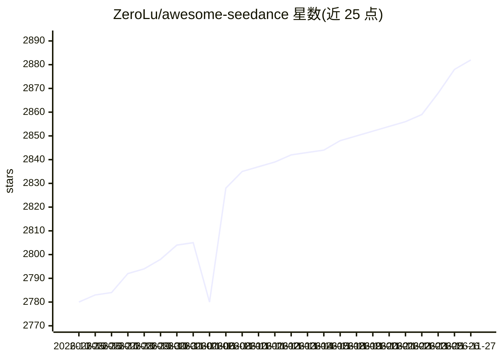

# ZeroLu/awesome-seedance

⭐ 2,882 · Shell · MIT · 推送 2026-11-26 · [GitHub](https://github.com/ZeroLu/awesome-seedance) · [官网](https://cyberbara.com/seedance2.0?utm_source=awesome-seedance) · 个人维护 · 中文 README

**给视频创作者的 Seedance 2.0 提示词与资源合集**

按类别策展的 Seedance 2.0 提示词清单：从 X (Twitter)、微信与提示词工程师处收集素材，分为电影风格、广告品牌、社媒表情包、UGC、动漫动画、短剧、视觉特效等板块，每条附完整提示词文本与示例视频链接，部分条目标注作者来源。另含 API 与使用教程类资源章节，接受贡献者提交。README 提供英、中、德、法、西、日多语言入口，以 MIT 许可发布。

## 筛选速览

| 维度 | 判定 | 备注 |
|---|---|---|
| AI 角色 | `ai-knowledge` | 知识聚合/清单类 |
| 许可风险 | `permissive` | MIT |
| 部署形态 | `None` |  |
| 模型依赖 | — | README 未给出锁定关系 |
| 硬件要求 | — | 无带数字的原话,不猜 |
| 安装摩擦 | `low` | 无编译、无系统依赖或容器化 |
| 成熟度 | — | 结构信号不足 |

## 能力要点

- 按 7 个创作场景分类组织 Seedance 2.0 提示词
- 每条提示词附示例视频链接与作者来源标注
- 含时间戳分段式长镜头提示词写法示例（15 秒分镜）
- README 提供六种语言版本

## 适用场景

- 为广告片查找可复用的 Seedance 2.0 提示词模板
- 学习电影感视频生成的分段提示词写法
- 制作社媒短视频或表情包素材时参考风格化提示词

## 场景标签

`精选清单` `提示工程` · 领域:Agent 开发

## 证据(README 行号)

> L9: > A curated collection of the **best Seedance 2.0 prompts**, video generation techniques, and resources for advanced
> L25: ## 📖 Table of Contents
> L34: 8. Resources (API & How-to-use)

## 星数曲线

2026-10-25 2,780 → 2026-11-27 2,882（+102）

---
*卡片 v1 · prompt 1.4 · 生成 2026-11-27 · 置信度 high · 依据 README sha `0eb4c91dbab5` · [字段定义](../../DATASET.md)*
