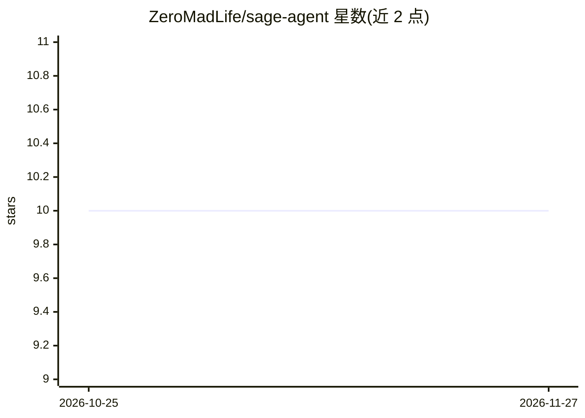

# ZeroMadLife/sage-agent

⭐ 10 · Python · MIT · 推送 2026-08-25 · [GitHub](https://github.com/ZeroMadLife/sage-agent) · 个人维护 · 中文 README

**本地优先的个人 AI 学习实践工作台：串联目标、知识与可验证证据**

Sage 是面向本地部署的个人 AI 学习与实践工作台，含 Assistant 对话、Knowledge 知识管理与 Practice Engine 代码实践三个产品表面，共享同一 Agent Harness 运行时。工程机制包括受限 JSON task_dag 编排、SQLite/PostgreSQL Agentic RAG（tsvector+pgvector+RRF）、citation-bound 证据门禁、分层 Eval 指标、proposal-first 长期记忆治理与 seccomp 容器 Sandbox。仅面向本地开发学习场景，不提供公网私人工作区入口。

## 筛选速览

| 维度 | 判定 | 备注 |
|---|---|---|
| AI 角色 | `ai-native` | 本体是模型或模型工具 |
| 许可风险 | `permissive` | MIT |
| 部署形态 | `self-host` | docker 或自建部署 |
| 模型依赖 | — | README 未给出锁定关系 |
| 硬件要求 | — | 无带数字的原话,不猜 |
| 安装摩擦 | `low` | 无编译、无系统依赖或容器化 |
| 成熟度 | — | 结构信号不足 |

## 能力要点

- PostgreSQL Agentic RAG：GIN tsvector、pgvector cosine 与 RRF 融合排序
- 动作经 Permission/Policy/Approval/Sandbox 多层授权，seccomp+cap-drop 隔离
- 分层 Eval：intent/retrieval/claim/generation/recovery/provider 六层指标
- 长期记忆 proposal-first 治理：显式批准后才成为 active fact

## 适用场景

- 把学习目标与个人知识库、代码实践、运行证据串联管理
- 本地搭建带审批与沙箱的 Agent 编码实践环境
- 对 RAG 检索与回答质量做分层评测

## 场景标签

`Agent 记忆` `编码 Agent` `模型评测` `知识库管理` · 领域:Agent 开发

## 证据(README 行号)

> L39: Sage 不是给聊天框加几个工具，而是一个本地优先的个人 AI 学习与实践工作台。它把对话、个人知识、代码仓库、工具执行、审批、Sandbox 和评测放进同一个 Agent Harness，并把运行过程沉淀为可恢复、可复核的证据。
> L3:  本地优先的 Personal AI Learning Companion，把目标、个人知识、真实实践与可验证证据连接成一条可恢复的 Agent 执行链。
> L58: 当前仓库面向本地开发与学习使用，不提供私人工作区的公网入口，也不把公开 Agent 当成私人 Harness。

## 星数曲线

2026-10-25 10 → 2026-11-27 10（+0）

---
*卡片 v1 · prompt 1.4 · 生成 2026-11-20 · 置信度 high · 依据 README sha `eacfbd14e74e` · [字段定义](../../DATASET.md)*
