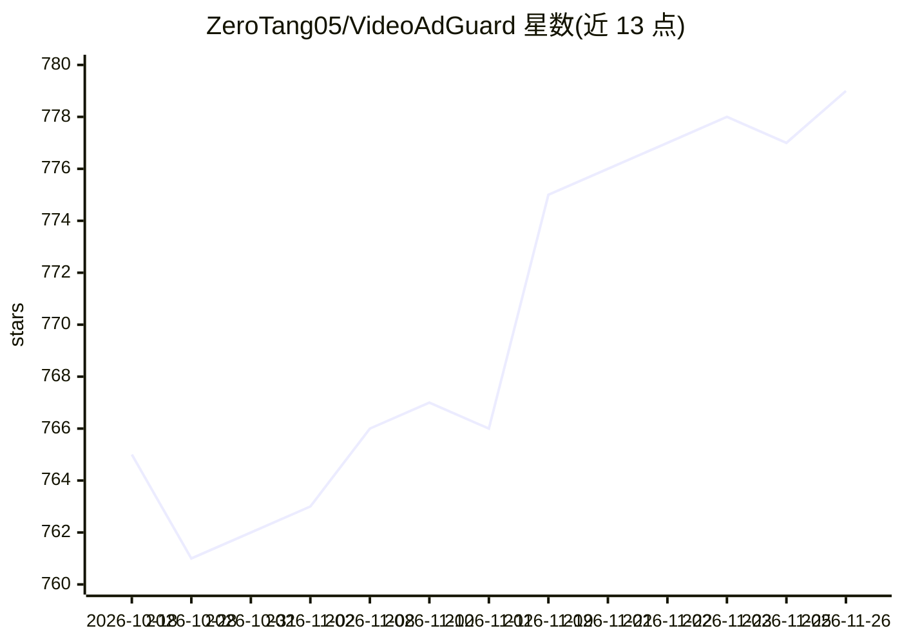

# ZeroTang05/VideoAdGuard

⭐ 779 · TypeScript · GPL-2.0 · 推送 2026-11-25 · [GitHub](https://github.com/ZeroTang05/VideoAdGuard) · [官网](https://vag.xiaobaozi.cn) · 个人维护 · 中文 README

**B站浏览器插件：用大语言模型检测并跳过植入广告**

面向B站视频观看者的浏览器扩展（Edge/Chrome/Firefox）与油猴脚本：获取视频字幕（无字幕时用Groq Whisper转录音频），连同标题与置顶评论送入大语言模型判断广告区间，在播放器显示跳过按钮并支持自动跳过。检测结果本地缓存24小时，可选云端共享缓存与社区反馈（区间修正、AI文案标注、AI评论屏蔽）。需用户自行配置LLM API密钥；油猴脚本版声明不再维护。

## 筛选速览

| 维度 | 判定 | 备注 |
|---|---|---|
| AI 角色 | `ai-native` | 本体是模型或模型工具 |
| 许可风险 | `viral` | GPL-2.0 |
| 部署形态 | `library` | 以包/库形式分发 |
| 模型依赖 | local-ok | 支持本地模型 |
| 硬件要求 | — | 无带数字的原话,不猜 |
| 安装摩擦 | `low` | 无编译、无系统依赖或容器化 |
| 成熟度 | — | 结构信号不足 |

## 能力要点

- 基于视频字幕/音频转录的LLM广告区间检测与一键跳过
- 本地24小时缓存与云端社区共享检测结果
- 支持OpenAI兼容、Anthropic兼容、System One、自定义Fetch多种SDK接入
- 本地Ollama模型部署路径与社区反馈机制

## 适用场景

- 看B站视频时自动识别并跳过植入/口播广告
- 无字幕视频通过音频识别检测广告
- 与社区共享广告区间，减少重复检测开销
- 用本地Ollama模型避免字幕数据外传

## 场景标签

 · 领域:浏览器扩展/内容过滤

## 证据(README 行号)

> L5: VideoAdGuard 是一个基于大语言模型的B站视频植入广告检测工具，能够自动识别B站视频中的植入广告内容，并提供跳过广告的功能。
> L44: - 🎯 **精准识别**：采用大语言模型分析视频字幕，准确定位植入广告内容
> L179: 1. 获取视频字幕内容（如无字幕则启用音频识别）

## 星数曲线

2026-10-18 765 → 2026-11-26 779（+14）

---
*卡片 v1 · prompt 1.4 · 生成 2026-11-26 · 置信度 high · 依据 README sha `40bf51e0e08f` · [字段定义](../../DATASET.md)*
