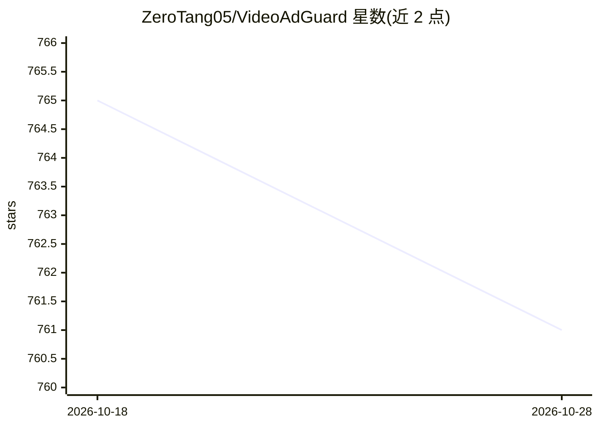

# ZeroTang05/VideoAdGuard

⭐ 761 · TypeScript · GPL-2.0 · 推送 2026-10-27 · [GitHub](https://github.com/ZeroTang05/VideoAdGuard) · [官网](https://vag.xiaobaozi.cn) · 个人维护 · 中文 README

**基于大语言模型的B站视频植入广告检测与跳过浏览器插件**

VideoAdGuard 是面向B站观众的浏览器插件（Edge/Chrome/Firefox 及油猴脚本版），通过大语言模型分析视频字幕（无字幕视频经 Groq Whisper 音频转录）识别植入/口播广告，标记广告区间并支持一键或自动跳过。用户需自行配置 LLM API（支持 OpenAI 兼容、Anthropic 兼容、System One、自定义 Fetch 接入 Ollama/vLLM 等本地模型）。提供本地 24 小时缓存与云端社区共享缓存，检测结果与准确度依赖所用模型能力，可从商店安装或 npm 自行构建。

## 筛选速览

| 维度 | 判定 | 备注 |
|---|---|---|
| AI 角色 | `ai-native` | 本体是模型或模型工具 |
| 许可风险 | `viral` | GPL-2.0 |
| 部署形态 | `library` | 以包/库形式分发 |
| 模型依赖 | local-ok | 支持本地模型 |
| 硬件要求 | — | 无带数字的原话,不猜 |
| 安装摩擦 | `low` | 无编译、无系统依赖或容器化 |
| 成熟度 | — | 结构信号不足 |

## 能力要点

- LLM 分析字幕定位植入广告区间，一键/自动跳过
- 无字幕视频自动启用 Groq Whisper 音频识别
- 本地 24h 缓存 + 云端社区共享检测结果与用户反馈修正
- 支持 OpenAI 兼容/Anthropic 兼容/System One/自定义 Fetch 多种 SDK 接入含本地 Ollama/vLLM

## 适用场景

- 看B站视频时跳过植入或口播广告片段
- 无字幕视频通过音频识别检测广告
- 不愿使用云端 API 时接入本地 Ollama 模型保护隐私

## 场景标签

 · 领域:浏览器插件/LLM 应用

## 证据(README 行号)

> L5: VideoAdGuard 是一个基于大语言模型的B站视频植入广告检测工具，能够自动识别B站视频中的植入广告内容，并提供跳过广告的功能。
> L44: - 🎯 **精准识别**：采用大语言模型分析视频字幕，准确定位植入广告内容

## 星数曲线

2026-10-18 765 → 2026-10-28 761（-4）

---
*卡片 v1 · prompt 1.4 · 生成 2026-10-28 · 置信度 high · 依据 README sha `2b88898a74f2` · [字段定义](../../DATASET.md)*
